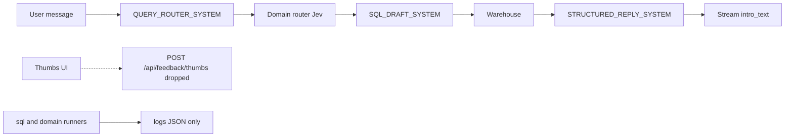

# PropQA: How to implement the improvement plan

**October 2026.** This guide turns [PropQA_Improvement_Plan.md](PropQA_Improvement_Plan.md) into work on the code that is already here. Read that plan for the why. Read this file for the where and the order.

The bot stays as it is until you do the steps below. This document does not change routing, SQL, or the UI.

Do these four changes in order. Each one depends on the one before it.

| # | Change | Size | Start here |
| --- | --- | --- | --- |
| 1 | One eval system, frozen holdout, merge gate | ~2 weeks | Existing runners under `src/evals/` |
| 2 | Store the thumbs the UI already sends | ~2 days | `POST /api/feedback/thumbs` has no route |
| 3 | Check that every number in a reply comes from the data | ~4 days | New `src/agent/reply/grounding_check.py` |
| 4 | GEPA on the query router, then the SQL drafter | ~2 weeks | After 1–3, and only with a human PR |

Out of scope, on purpose: new data domains, a new UI, a model or framework swap, DSPy, a new clarify route, and any prompt that changes itself in production.

---

## 1. What the source plan got right, and what has moved

The design in the source plan still fits. A few counts and files have moved since it was written. Use these numbers.

| Area | Source plan | This repo today |
| --- | --- | --- |
| Lookup cases | 20 in `sql_golden.yaml` | **45** cases in [src/evals/sql_golden.yaml](src/evals/sql_golden.yaml). Truth is still SQL, scored on the live warehouse. |
| Domain cases | 39 | **50** cases in [src/evals/domain_router_golden.yaml](src/evals/domain_router_golden.yaml). `score_route` is in [src/evals/run_domain_eval.py](src/evals/run_domain_eval.py). |
| Router cases | 10, mocked only | **11** cases in [src/evals/router_golden.yaml](src/evals/router_golden.yaml). Only [src/agent/tests/test_router.py](src/agent/tests/test_router.py) reads them. There is no live router runner. |
| Real queries | ~170 in `testquries.md` | [testquries.md](testquries.md) groups them by domain. The file's own table sums to **184** (95 property search, 31 market intel, 13 off-plan, 12 RTA, 6 communities, 2 location, 15 multi-domain, 7 follow-ups, 3 general). Typos are kept. |
| Reply claims | "Nothing checks intro_text" | Listing replies already have an LLM claim check: [src/evals/listing_justification.py](src/evals/listing_justification.py), called from [src/evals/run_sql_eval.py](src/evals/run_sql_eval.py). [src/evals/listing_score.py](src/evals/listing_score.py) also checks reply phrases. The **number** check in Change 3 is still missing. |
| Name grounding | Not the same thing | [src/agent/grounding/](src/agent/grounding/) resolves place and advertiser names. Leave it alone. Answer grounding is a new module under `src/agent/reply/`. |
| Feedback | UI posts, backend drops the vote | Still true. See Change 2. |
| CI | "Every PR" | There is no `.github` workflow. Pytest is local, configured in [pyproject.toml](pyproject.toml). The merge gate is a new workflow. |
| SQL limits | Keep timeout and row cap | Already set in [src/config/settings.py](src/config/settings.py): `SQL_TIMEOUT_MS` defaults to 15 seconds, `SQL_ROW_CAP` defaults to 100. |

### Pipeline the four changes plug into



- Query router prompt: `QUERY_ROUTER_SYSTEM` in [src/agent/prompts/query_router.py](src/agent/prompts/query_router.py). Called by `LangChainAgentModels.route_query` in [src/agent/services/llm/models.py](src/agent/services/llm/models.py).
- Domain router: Jev, in [src/agent/services/jev_domain_router.py](src/agent/services/jev_domain_router.py). You do not own that prompt. Leave it out of GEPA.
- SQL drafter: `SQL_DRAFT_SYSTEM` in [src/agent/prompts/sql.py](src/agent/prompts/sql.py).
- Reply: `STRUCTURED_REPLY_SYSTEM` in [src/agent/prompts/reply.py](src/agent/prompts/reply.py). `intro_text` streams as it is written in [src/agent/reply/streaming.py](src/agent/reply/streaming.py).
- Fixed compliance text already sits apart from the prompts, in [src/agent/prompts/scope.py](src/agent/prompts/scope.py): `IN_SCOPE_SUBJECTS`, `GOLDEN_VISA_FACTS`, `NO_INFERENCE_FROM_NAMES`. The prompt files interpolate those constants. GEPA must keep editing only the text around them.
- Figure formatting the grounding check must match: `format_figure` in [src/agent/reply/figures.py](src/agent/reply/figures.py).
- Langfuse: [src/agent/graph/runner.py](src/agent/graph/runner.py), [src/agent/services/tracing.py](src/agent/services/tracing.py), [src/agent/sql/trace.py](src/agent/sql/trace.py). Traces exist. They are not tagged with `prompt_version`, `route`, `domain_ids`, or `fallback_fired`.

`LangChainAgentModels.__init__` takes only `domain_router` today and always uses the module-level prompt constants. Production behaviour stays the same until Change 4 adds an optional `prompts` override and production keeps passing nothing.

---

## 2. Change 1 — one eval system

Do this first. Later changes are measured against it. GEPA has nothing to optimise until the holdout set and the written failure reasons exist.

Build on the runners. Keep [src/evals/run_sql_eval.py](src/evals/run_sql_eval.py) and [src/evals/run_domain_eval.py](src/evals/run_domain_eval.py). Add a router runner and one entry point that calls all three.

### 2.1 Scores

| Score | Question | Where to score it |
| --- | --- | --- |
| Route accuracy | Right route (`need_db`, `direct_answer`, `out_of_scope`) and turn kind? | New `python -m evals.run_router_eval`. Exact match against labels. |
| Domain accuracy | Right domains, joins, and recipe? | Existing `score_route` in [src/evals/run_domain_eval.py](src/evals/run_domain_eval.py). |
| Result correctness | Right listings or the right figure? | Existing scorers in [src/evals/run_sql_eval.py](src/evals/run_sql_eval.py): listing ids vs truth SQL (`fetch_truth_ids`), value within tolerance, `sql_contains`, `rows_contain`. |
| Answer grounding | Is every number in the reply backed by the data? | Change 3. Wire the score in once that checker exists. |
| Usefulness (judge) | Does it answer the question, and does it state relaxed filters? | New, narrow judge. Off the merge gate until it is calibrated. |

Result correctness is the score that can block a release. Latency, fallback rate, and cost per turn are printed beside the scores. They never block a change on their own.

Listing justification stays the listing-claim check it already is. The usefulness judge is a second, smaller check. It asks three yes/no questions, not a 1-to-10 rating:

- Does the reply answer the question the user asked?
- When a filter was relaxed or `search_notes` exist, does the reply say so?
- Does it claim anything about a listing, area, or developer that the rows do not support?

Two people label 50 replies first. Trust the judge only if it agrees with them on at least 85% of answers for each question. Until then, `run_all` can record the judge and must ignore it when deciding pass or fail.

### 2.2 Case fields

Add these fields to cases in the three YAML files. The runners ignore unknown keys today, so you can add the fields before every runner reads them.

- `split`: `train`, `val`, or `holdout`. Write it once and do not reshuffle. Holdout cases are never shown to GEPA and never used to write a prompt rule. They are the only set that can block a release.
- `tags`: domain, kind, and whether the case is hard, so a regression shows where it happened.
- `must_pass`: boolean. About 15 cases. Any failure blocks the run. Include "show me properties in Dubai Marina", "what is RERA", and the existing out-of-scope code request (`code_request` in [src/evals/router_golden.yaml](src/evals/router_golden.yaml)).

### 2.3 Grow the sets from real queries

Label lines from [testquries.md](testquries.md). Keep the current convention: lookup truth is SQL run against the live warehouse at eval time, because a stored expected number goes stale.

| Set | Today | Target | Source |
| --- | --- | --- | --- |
| Router | 11 | 150 | One label per line in `testquries.md` |
| Domain | 50 | 100 | The `need_db` subset |
| Lookup (SQL truth) | 45 | 120 | About 12 per domain: typos, multi-place, OR-amenities, budgets, empty results |
| Multi-turn | a handful (`turns` already exists on some SQL cases, including `refine_keeps_place`) | 20 | Refine, "cheaper", pronoun follow-ups, focused listings |

Labeling is most of the two weeks. The runners are the smaller part.

### 2.4 A sentence for every failure

Every scorer returns a score and one sentence a person, or GEPA, can act on. [src/evals/listing_score.py](src/evals/listing_score.py) already builds a detail string (`truth=`, `wrong_ids=`, `missing relaxation note`). Extend that style to the router, domain, and value scorers.

The sentence should name the case, what was wrong, and the concrete cause. Example:

> FAIL marina_two_bed: 3 of 10 listings are outside Dubai Marina. The SQL filtered `address_en ILIKE '%marina%'` instead of the stored value `Dubai Marina`. The 2-bedroom filter is missing.

GEPA learns from this text, not only from the score. This is what makes Change 4 work.

### 2.5 Runners and the gate

Add:

- `python -m evals.run_router_eval` — calls `LangChainAgentModels.route_query` (same method production uses) and scores route and turn kind. Once the labels exist, also score names, limits, and filters. The mocked test in [src/agent/tests/test_router.py](src/agent/tests/test_router.py) stays. It does not hit the network.
- `python -m evals.run_all [--split holdout]` — calls the router, domain, and SQL runners, writes one JSON report, and records a Langfuse dataset run when `LANGFUSE_PUBLIC_KEY` and `LANGFUSE_SECRET_KEY` are set ([src/agent/services/tracing.py](src/agent/services/tracing.py) already no-ops without them).

How it runs:

- **Every PR:** existing pytest plus the grounding checker unit tests from Change 3. No network.
- **PRs that touch prompts, catalog, SQL, or grounding:** full holdout via `run_all --split holdout`. Block on any `must_pass` failure, or if holdout result correctness drops by more than 2 points from the stored baseline.
- **Nightly on main:** same holdout run, so warehouse drift and model drift show up within a day.

There is no GitHub Actions workflow in this repo. Add one. Pytest paths are already declared in [pyproject.toml](pyproject.toml) (`src/common/tests`, `src/agent/tests`, `src/routes/tests`, `src/evals/tests`). The full eval needs warehouse and model credentials, so keep it off the default unit-test job.

### 2.6 Weekly triage

This is a habit, not a feature. Each week, take 30 to 50 production traces: thumbs-down first (that signal exists only after Change 2), then turns where a fallback fired or the lookup came back empty. Each real failure becomes one case with SQL truth, in `train` or `val`. Holdout stays frozen until the quarterly refresh in Change 4.

### 2.7 Done when

- `python -m evals.run_all --split holdout` prints route accuracy, domain accuracy, and result correctness, each with a failure sentence, and writes a JSON report.
- `must_pass` cases fail the process when any one of them fails.
- Holdout ids are listed in the YAML and are excluded from any train or val export.
- A baseline number exists. Week 6 targets are relative to this baseline. Do not invent it.

---

## 3. Change 2 — close the feedback loop

The UI already collects the vote. The server drops it.

[Frontend_Gerenal/src/components/chat/MessageList.tsx](Frontend_Gerenal/src/components/chat/MessageList.tsx) calls `analyticsApi.submitFeedback`. [Frontend_Gerenal/src/api/analyticsApi.ts](Frontend_Gerenal/src/api/analyticsApi.ts) posts this body to `POST /api/feedback/thumbs`:

```json
{
  "thumbs": "up or down",
  "message_id": "message id",
  "session_id": "session id",
  "comment": "optional",
  "turn_id": "turn id",
  "user_message": "user text",
  "assistant_message": "assistant text"
}
```

`apiFetch` in that file returns the fallback on any non-OK response, so a 404 looks like success in the UI. After the route exists, a failed post should surface. Until then, do not trust the client as proof that a vote was stored.

[src/app.py](src/app.py) mounts auth, chat, sessions, leads, and memory under `/api`. It does not mount feedback.

### 3.1 The route

Add [src/routes/feedback.py](src/routes/feedback.py) and include it from [src/app.py](src/app.py) with prefix `/api`.

- Accept the body above. `thumbs` is `up` or `down`.
- Auth is already applied: `AuthMiddleware` wraps the app before the routers.
- Rate-limit it the same way as chat. Copy the pattern in [src/routes/chat.py](src/routes/chat.py): `declare_rate_limits`, `enforce` with `caller_rate_limit_key`, and visitor vs registered limits from [src/common/ratelimit/rules.py](src/common/ratelimit/rules.py) (`CHAT_VISITOR` is 20/minute, `CHAT_REGISTERED` is 60/minute). A thumbs route can use the generic API ceilings (`API_VISITOR` 60/minute, `API_REGISTERED` 300/minute) if you would rather not share the chat bucket. Pick one and document it on the route.

Leave `POST /api/feedback/correction`, `GET /api/feedback/stats`, and the admin eval routes alone. The client already calls some of them and degrades to empty data. The source plan only requires thumbs.

### 3.2 Stable turn id

The `turn_id` the UI sends today cannot be the key.

[src/common/session/transcript.py](src/common/session/transcript.py) builds each turn with `"turn_id": str(uuid.uuid4())` inside `_pair_messages_into_turns`. Every `GET /sessions/{session_id}/turns` in [src/routes/sessions.py](src/routes/sessions.py) therefore returns a new id. A vote stored against that id will not match the turn after a reload.

Do this instead:

1. When the assistant message is written, store a stable id on it. The place to do that is `_reply_state_update` in [src/agent/graph/nodes/reply.py](src/agent/graph/nodes/reply.py), which already puts listing ids on the checkpoint message:

```377:380:src/agent/graph/nodes/reply.py
    message = AIMessage(
        content=content,
        additional_kwargs={"listing_ids": ids} if ids else {},
    )
```

   Always set `additional_kwargs["turn_id"]` to a UUID created once for that message. Keep `listing_ids` beside it. Older checkpoints have no `turn_id`; for those, fall back to matching `session_id` plus the user and assistant text the client already sends.

2. In [src/common/session/transcript.py](src/common/session/transcript.py), read that `turn_id` back the same way `_message_listing_ids` reads `listing_ids`. Return it as `turn_id`. Stop minting a fresh UUID when the message already has one.

3. Persist the vote in a small Postgres table, not on the checkpoint. A later thumbs click should not rewrite LangGraph state. Columns: session id, stable turn id, thumbs (`up` or `down`), optional comment, Langfuse trace id, created at. One row per turn; a second vote updates the row. Follow the `CREATE TABLE IF NOT EXISTS` style in [src/auth/storage/postgres.py](src/auth/storage/postgres.py).

4. `GET /sessions/{session_id}/turns` joins that table and adds `thumbs_up` and `thumbs_down` on each turn. [Frontend_Gerenal/src/hooks/useChat.ts](Frontend_Gerenal/src/hooks/useChat.ts) and [Frontend_Gerenal/src/api/sessionApi.ts](Frontend_Gerenal/src/api/sessionApi.ts) already read those fields. The UI needs no new screen.

### 3.3 Trace tags

On each chat turn, tag the Langfuse trace. [src/agent/graph/runner.py](src/agent/graph/runner.py) already opens the trace with `propagate_attributes(user_id=..., session_id=...)` and a `CallbackHandler`. Add:

- `prompt_version`: a short hash of each prompt actually used (`query_router`, `sql_draft`, `structured_reply`). Hash the full string after the `scope.py` constants are interpolated, so a compliance edit changes the version too.
- `route`
- `domain_ids`
- `fallback_fired`: true when a call returned the fallback object.

The fallback decision is in `invoke_structured_with_fallback` in [src/agent/services/llm/calls.py](src/agent/services/llm/calls.py). Both failure paths `return fallback` and do not record that fact. Have that function report it (a counter or a flag on the turn) so the trace tag is not a guess.

Store the Langfuse trace id on the turn row (or in `additional_kwargs` next to `turn_id`) so the thumbs route can attach a score without searching by session.

When a thumbs vote is stored, write a Langfuse score named `user_feedback` on that trace. Thumbs-up rate can then be split by `prompt_version`, which the GEPA rollout in Change 4 needs.

### 3.4 Done when

- A thumbs click returns 200 and a row exists after restart.
- Reloading the session shows the same thumb on the same message.
- The Langfuse trace for that turn has `prompt_version`, `route`, `domain_ids`, `fallback_fired`, and, after a vote, a `user_feedback` score.

---

## 4. Change 3 — answer grounding

For a buyer, one wrong price or count does more damage than a clumsy sentence. Figures drawn by code are already safe: `build_figures` and `format_figure` in [src/agent/reply/figures.py](src/agent/reply/figures.py) copy values from rows. The free text in `intro_text`, and any numbers in card text, are not checked.

Add [src/agent/reply/grounding_check.py](src/agent/reply/grounding_check.py). Plain Python. No LLM. This is separate from [src/agent/grounding/](src/agent/grounding/).

### 4.1 The check

- Extract every number from the reply: prices (`AED 1.2M`, `AED 1,195,000`), counts, sizes, percentages, years.
- Normalise them the way `format_figure` formats values, so `AED 1.2M` matches `1195000` within display rounding. Reuse `_format_aed_amount` and `_format_grouped_number` rather than copying the rounding rules. AED millions use two decimal places of millions; amounts under 1,000 keep two decimal places; counts are integers; years are integers; percents use two decimal places.
- Accept a number when it matches any of: a row value, a listing fact, `listing_count`, a number in the user's own filters, a coverage date, the Golden Visa threshold in `GOLDEN_VISA_FACTS` ([src/agent/prompts/scope.py](src/agent/prompts/scope.py), value from `GOLDEN_VISA_MIN_PRICE_AED`), or a simple derived value (min, max, or row count of one column).
- Flag anything left over. Return the flagged strings and a one-line reason each, in the same style as the eval failure sentences.

Unit tests live under `src/agent/tests/` (pytest already collects that tree) and must run with no network. Cases to cover: `AED 1.2M` matches `1195000`; a count copied from `listing_count` passes; a number with no source is flagged; Golden Visa minimum is allowed when the reply is about that visa.

### 4.2 Where it runs

- **Evals:** `run_all` records an answer-grounding score from this function. It can fail a case. It does not replace listing justification.
- **Production, phase 1:** run it after the reply is complete, and record a Langfuse score. Leave the reply unchanged. `intro_text` streams to the user as it is written, so the check cannot rewrite tokens already sent.
- **Production, phase 2:** only if the flagged rate on data-backed turns stays above about 2%. Then add a UI event that replaces the flagged reply. Do not build phase 2 in the first pass.

### 4.3 Done when

- Unit tests pass offline.
- A holdout run reports the share of data-backed replies that contain an ungrounded number.
- Production traces get a grounding score, and the user still sees the original streamed text.

---

## 5. Change 4 — GEPA

Start this only after `run_all --split holdout` is the gate, thumbs are stored with `prompt_version`, and the grounding checker is scoring. GEPA proposes. A person decides. Nothing in production changes by itself.

GEPA (Genetic-Pareto reflective prompt evolution) rewrites a prompt from the system's own failure sentences, keeps a candidate only when it scores better, and keeps every prompt that is best on at least one validation case. The output is plain prompt text in a PR.

### 5.1 What to optimise, in order

| Stage | Prompt | Metric | Why this order |
| --- | --- | --- | --- |
| A | `QUERY_ROUTER_SYSTEM` | Route and turn-kind accuracy; names, limits, and filters once labeled | One fast-model call, no warehouse. Errors here spread to every later step. |
| B | `SQL_DRAFT_SYSTEM` | Result correctness. Guard rejections and retry reasons are part of the feedback text. | Most wrong answers start here. The metric already runs the SQL. |
| C, later | `STRUCTURED_REPLY_SYSTEM` | Answer grounding plus the calibrated judge | Only after A and B have shipped and the judge agrees with people at 85%. |

The domain router stays out. It is scored by `run_domain_eval`, and the prompt lives in Jev.

### 5.2 Split fixed text from optimisable text

[src/agent/prompts/query_router.py](src/agent/prompts/query_router.py), [src/agent/prompts/sql.py](src/agent/prompts/sql.py), and [src/agent/prompts/reply.py](src/agent/prompts/reply.py) build their strings with f-strings that embed [src/agent/prompts/scope.py](src/agent/prompts/scope.py).

Split each target prompt into:

- a fixed prefix and suffix that still interpolate `IN_SCOPE_SUBJECTS`, `GOLDEN_VISA_FACTS`, and `NO_INFERENCE_FROM_NAMES`;
- an optimisable middle, a plain string GEPA may rewrite.

GEPA never receives the fixed blocks as editable text. Production concatenates fixed plus middle, exactly as the f-string does today, so a run with the seed middle matches current behaviour.

### 5.3 Adapter

Add an optional `prompts` argument to `LangChainAgentModels.__init__` in [src/agent/services/llm/models.py](src/agent/services/llm/models.py). Keys: `query_router`, `sql_draft`. When the argument is omitted, use the current constants. `route_query` and the SQL draft call then read `self` prompts instead of the imported constants. Every existing caller passes nothing, so chat behaviour does not change.

New package: `src/evals/gepa/`.

- `optimize_router.py` first, then `optimize_sql.py`.
- Depend on the standalone `gepa` package. Pin it. Read its adapter API before copying the sketch in section 6.3 of the source plan. The sketch (`evaluate`, `make_reflective_dataset`, `gepa.optimize`) is the shape to aim for. The real method names win if they differ.
- The adapter calls `LangChainAgentModels`, not a reimplemented router. Task model is the production model for that step. Reflection model is the strongest model you have, set by `GEPA_REFLECTION_MODEL`.
- No DSPy. No rewrite of the LangGraph nodes.

Router adapter, in outline:

- `evaluate` builds `LangChainAgentModels(prompts={"query_router": candidate})`, runs `route_query` on the batch, and returns scores plus the failure sentence from the router scorer.
- `make_reflective_dataset` turns those sentences into feedback the reflection model can read (`Inputs`, `Generated Outputs`, `Feedback`).
- Train and val come from cases whose `split` is `train` or `val`. Holdout is not in that call.

Budget: about 10 passes over train and val. For the router, `max_metric_calls` around 1500. Estimate cost before a run (cases × passes × tokens). Stage B runs SQL, so it must keep `SQL_TIMEOUT_MS` and `SQL_ROW_CAP`. Reject any candidate more than 30% longer than the seed. Prompt growth is the problem this replaces.

### 5.4 How a candidate reaches production

GEPA writes its best candidate, the score history, and a diff to `src/evals/gepa/runs/<date>/`.

A person then:

1. Runs that candidate on **holdout** through `run_all`.
2. Checks three bars: every `must_pass` case passes; the candidate beats the current prompt on its own metric; no other score drops by more than 1 point.
3. Reads the diff. Rejects wording that names one test building or one golden case.
4. Opens a normal PR that replaces the optimisable middle.

After deploy, compare a week of thumbs-up rate, fallback rate, empty-result rate, and grounding rate, split by `prompt_version` from Change 2. Roll back by reverting the PR.

Each month, GEPA may run again on the updated train and val sets. Each quarter, refresh the holdout from new production cases so it stays representative. Weekly triage (section 2.6) is what feeds the next month.

A bug fix still ships as a normal change, and it adds an eval case in the same PR. A prompt rule without a case is a miss on the week-6 target.

### 5.5 Done when

- A router GEPA run writes a candidate and a diff under `src/evals/gepa/runs/<date>/`.
- The seed candidate, passed as `prompts={"query_router": <current middle>}`, scores the same as production on the router holdout.
- Holdout bars above are written down next to the diff before any PR.
- Production still uses the previous prompt until that PR merges.

---

## 6. Six weeks

Measure the baseline at the end of week 2, from `run_all --split holdout`. Targets are relative to that run.

| Week | Work | Exit |
| --- | --- | --- |
| 1 | Case fields (`split`, `tags`, `must_pass`). Router runner. `run_all`. Start labeling `testquries.md`. | `run_all --split holdout` runs, even on the sets you have now. |
| 2 | Finish the first cut of labels. Failure sentences on every scorer. Store the baseline. Nightly job sketched. | Baseline numbers exist. `must_pass` blocks the run. |
| 2, in parallel, ~2 days | Change 2: feedback route, stable `turn_id`, vote table, trace tags. | A reload keeps the thumb. Traces carry `prompt_version`. |
| 3 | Change 3: `grounding_check.py`, unit tests, eval score, Langfuse score in production (phase 1, reply unchanged). | Ungrounded-number rate is a number, not a guess. |
| 4 | Prompt split (fixed vs middle). `prompts` override. Pin `gepa`. Router adapter against train and val only. | Seed middle matches production router scores. |
| 5 | Router GEPA run. Human review. Holdout bars. PR if it clears them. | Either a merged router prompt or a written reject. |
| 6 | SQL-drafter GEPA, same gate. Compare a week of thumbs, fallbacks, empty results, and grounding by `prompt_version`. | Week-6 targets below, judged against the week-2 baseline. |

### Targets by the end of week 6

| Measure | Target |
| --- | --- |
| Holdout result correctness (lookups) | +10 points over the week-2 baseline |
| Holdout route accuracy | at least 95% |
| Data-backed replies with an ungrounded number | under 1% of turns |
| Production thumbs-down rate | 25% lower than the first two weeks of collected votes |
| `must_pass` failures on main | 0, every night |
| Prompt rules added without an eval case | 0 |

---

## 7. Leave these alone

- Domain-router prompt and Jev client.
- [src/agent/grounding/](src/agent/grounding/) (name grounding).
- Listing justification, except to keep its failure text specific enough for a person to act on.
- `POST /api/feedback/correction` and the admin analytics routes, unless a later request asks for them.
- Reply prompt (`STRUCTURED_REPLY_SYSTEM`) until the usefulness judge is calibrated.
- Automatic prompt writes in production. The only path into the product is a reviewed PR.
- The streamed reply in phase 1 of grounding. Record the score. Ship the original text.

When the week-6 targets hold, "is the bot better than last month?" has a number, and the next prompt change starts from a failure sentence instead of a new hand-written rule.
