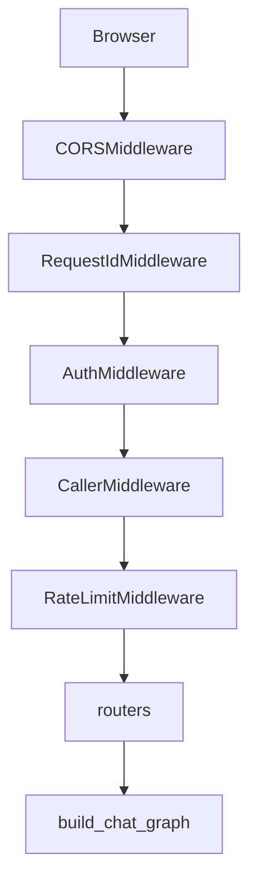

# Architecture

Deeper map of the processes and modules. Behavioural steps and line-level flow tables are in [WORKFLOW.md](WORKFLOW.md). Endpoint columns are in [API_REFERENCE.md](API_REFERENCE.md). Tables are in [DATA_MODEL.md](DATA_MODEL.md).

## Processes

Four application processes can run. Two of them are the same image with a different command (`Dockerfile:35`, `compose.yaml:62-70`).

| Process | Command | Opens |
| --- | --- | --- |
| api | `python src/app.py` (`src/app.py:90-104`) | HTTP, grounding thread, Redis checkpointer, chat DB pool on first memory or auth use, warehouse pool on first lookup |
| worker | `python -m agent.memory.worker` (`src/agent/memory/worker.py:1-6`) | Redis `memq`, chat DB memory pool. No HTTP |
| consolidate | same module with `--consolidate` (`src/agent/memory/write/worker.py:65-67`) | Chat DB. Exits after one pass |
| web | nginx serving `Frontend_Gerenal` `dist` (`Frontend_Gerenal/Dockerfile:11-13`) | HTTP :80. Proxies `/api/` and `/ws/` |

Postgres and Redis are Compose services, not Python (`compose.yaml:73-106`). The warehouse is external (`src/config/settings.py:46-58`).

## Request path

Registration order is the reverse of this picture, because Starlette runs the last added middleware first (`src/app.py:55-68`). The picture is the request direction.

Routers mounted at `/api` (`src/app.py:50-54`):

| Router | Module | Routes |
| --- | --- | --- |
| `auth_router` | `src/routes/auth.py:34` | 5, prefix `/auth` |
| `chat_router` | `src/routes/chat.py:23` | 1, `POST /chat` |
| `session_router` | `src/routes/sessions.py:31` | 13 session and preference handlers |
| `leads_router` | `src/routes/leads.py:13` | 1 |
| `memory_router` | `src/agent/memory/routes/user_memory.py:9` | 2 |

`src/agent/validator/routes.py` sanitizes domain-router output. It is not included by `create_app`.

## Chat turn modules

`stream_turn` (`src/agent/graph/runner.py:54-132`) compiles or reuses `get_chat_graph` (`src/agent/graph/workflow.py:136-147`) and streams `custom` plus `updates`.

| Module | In | Out |
| --- | --- | --- |
| `nodes/memory.py` | Redis working memory, memory repository | `query_frame`, recall, `memq` job, forget interrupt |
| `nodes/routing.py` | Router model, domain index text | `query_route`, `domain_route` |
| `nodes/catalog.py` | Domain YAML | `catalog_context` |
| `nodes/lookup.py` | Grounding index, `sql/lookup.py` | `sql_result`, `listing_ids`, SSE `listings` |
| `nodes/focus.py` | `sql/cards.py`, `sql/listing_details.py` | `focused_listings` |
| `nodes/reply.py` | Answer model or fixed strings | SSE `text` and `reply`, `AIMessage` |
| `nodes/turn_end.py` | State | Checkpoint fields cleared, `last_need_db`, `wm:{thread}` |

`AgentContext` (`src/agent/context.py:107-117`) carries `user_id` and optional test doubles: models, SQL runner, listing loaders, grounding. It is passed as LangGraph `context`, not stored in the checkpoint (`src/agent/graph/runner.py:76-82`).

## Provider selection

`LLM_PROVIDER` picks one vendor for every model slot (`src/config/settings.py:90-101`). Domain routing is a second switch: `DOMAIN_ROUTER` is `jev` when `JEV_API_KEY` is set, otherwise `llm` (`settings.py:110-112`). A Jev `TypeSafeError` is handled by falling through to the LLM router (see [WORKFLOW.md](WORKFLOW.md) section 10). Structured model calls retry once, then return the matching object in `src/agent/services/llm/fallbacks.py`.

## Frontend composition

`Frontend_Gerenal/src/main.tsx` mounts `App`. `App` chooses chat or `/dashboard` from `window.location.pathname` (`Frontend_Gerenal/src/App.tsx:57-66`). Chat traffic goes through `src/api/sseClient.ts` to `POST /api/chat`. Auth traffic goes through `src/store/authStore.ts`. Several clients call paths the API does not implement. Those are listed in [API_REFERENCE.md](API_REFERENCE.md) and [WORKFLOW.md](WORKFLOW.md) section 12.

## What is not in the process model

No Celery, APScheduler, cron, or FastAPI `BackgroundTasks` usage was found. The grounding loader is a daemon thread (`src/agent/grounding/index.py:166-168`). The memory worker is a separate process, not a thread inside the API.
