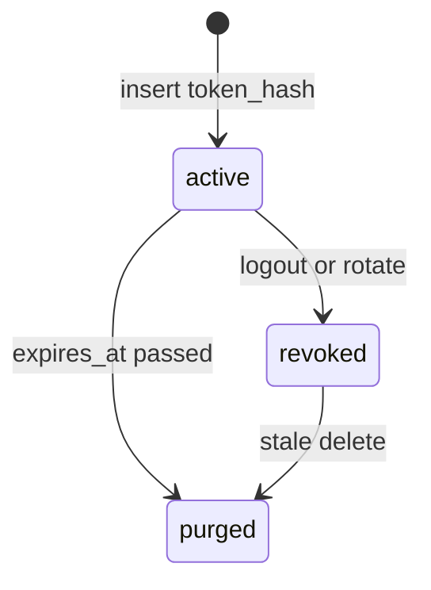
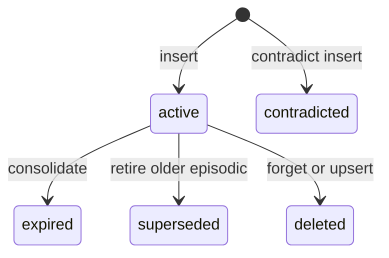
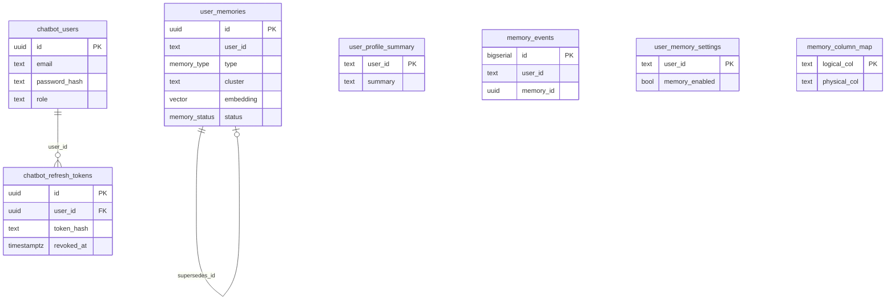

# Data model

Chat tables are created by Python DDL on first use. There is no Alembic tree. The warehouse schema is not created here. This file lists every `qualified_name` in `src/catalog/domains/*.yaml` and the columns this repo creates for the chat database. Column lists for warehouse tables are not in this repository, except the expressions selected by SQL that this repo writes.

See also [WORKFLOW.md](WORKFLOW.md) section 7 and [API_REFERENCE.md](API_REFERENCE.md).

## Chat Postgres

Pool name `auth` is opened for users (`src/auth/backends.py:13`, `39-45`). Pool name `memory` is opened by `open_long_term_store` (`src/agent/memory/session/backends.py:51-58`). `get_pool` without a connection string uses `chat_conninfo()` (`src/common/db/postgres.py:95`). Both use `CHAT_DB_*` (`src/config/settings.py:67-80`).

### Extensions and enums

Created in `src/agent/memory/storage/postgres.py:26-43`:

| Name | Values |
| --- | --- |
| extension `vector` | pgvector |
| extension `pgcrypto` | `gen_random_uuid` |
| `memory_type` | `profile`, `preference`, `semantic`, `episodic`, `goal`, `ephemeral` |
| `memory_provenance` | `explicit`, `inferred`, `system`, `summarized` |
| `memory_status` | `active`, `superseded`, `expired`, `deleted`, `contradicted` |

The Python enums match those strings (`src/agent/enums/memory.py:8-29`).

### `chatbot_users`

DDL `src/auth/storage/postgres.py:16-28`.

| Column | Type | Notes |
| --- | --- | --- |
| `id` | uuid PK | `uuid.uuid4()` on insert (line 72) |
| `email` | text NOT NULL | unique index `chatbot_users_email_idx` on `lower(email)` |
| `name` | text NOT NULL | |
| `phone` | text | nullable |
| `password_hash` | text NOT NULL | bcrypt |
| `role` | text NOT NULL | default `user`. Check `user` or `admin` |
| `created_at` | timestamptz | default `now()` |
| `updated_at` | timestamptz | default `now()`. Insert sets it. No UPDATE of user rows was found in this file |

Writes: `INSERT` in `create_user` (lines 66-72). Reads: by id (lines 81-82), by email (lines 85-88).

### `chatbot_refresh_tokens`

DDL `src/auth/storage/postgres.py:30-40`.

| Column | Type | Notes |
| --- | --- | --- |
| `id` | uuid PK | |
| `user_id` | uuid NOT NULL | FK `chatbot_users(id)` ON DELETE CASCADE |
| `token_hash` | text NOT NULL UNIQUE | hash of the opaque token |
| `expires_at` | timestamptz NOT NULL | |
| `revoked_at` | timestamptz | null while usable |
| `created_at` | timestamptz | |

Index `chatbot_refresh_tokens_user_idx` on `user_id` (lines 39-40).

`active` means `revoked_at IS NULL AND expires_at > now`, which is the rotate predicate (`src/auth/storage/postgres.py:106-108`). Logout sets `revoked_at` (lines 118-125). Rotate sets `revoked_at` and inserts the successor in one transaction (lines 103-116). `_purge_stale_tokens` deletes rows that are expired or already revoked when a new token is added (lines 144-150).

### `user_memories`

DDL `src/agent/memory/storage/postgres.py:45-76`.

| Column | Type | Notes |
| --- | --- | --- |
| `id` | uuid PK | default `gen_random_uuid()` |
| `user_id` | text NOT NULL | not a foreign key to `chatbot_users` |
| `type` | `memory_type` | |
| `cluster` | text NOT NULL | `MemoryCluster` values |
| `slot` | text | nullable |
| `content` | text NOT NULL | |
| `structured` | jsonb | |
| `embedding` | `vector(1024)` | HNSW `vector_cosine_ops`. Store is built with `embed=None` |
| `confidence` | real NOT NULL | |
| `importance` | real NOT NULL | |
| `provenance` | `memory_provenance` | |
| `source_thread_id` | text | |
| `source_message_id` | text | |
| `status` | `memory_status` | default `active` |
| `supersedes_id` | uuid | FK to `user_memories(id)` |
| `valid_from` | timestamptz | default `now()` |
| `expires_at` | timestamptz | |
| `last_accessed_at` | timestamptz | |
| `access_count` | int | default 0 |
| `created_at` | timestamptz | |
| `updated_at` | timestamptz | |

Indexes (lines 69-76):

- `user_memories_user_status_cluster_idx` on `(user_id, status, cluster)`
- `user_memories_user_slot_idx` on `(user_id, slot)` WHERE `status = 'active'`
- `user_memories_active_slot_idx` unique on `(user_id, slot)` WHERE `status = 'active' AND slot IS NOT NULL`
- `user_memories_embedding_idx` HNSW

Transitions: `expired` at `src/agent/memory/maintenance/consolidate.py:39`, `56`, and `127`. `superseded` at `consolidate.py:229`. `deleted` at `src/agent/memory/maintenance/privacy.py:30`, `src/agent/memory/write/upsert.py:233`, and `src/agent/memory/storage/langgraph_store.py:97`. A contradicting insert uses status `contradicted` (`src/agent/memory/write/upsert.py:208`).

`user_id` is text. Guest ids (`anon-` plus a UUID) and registered user ids can both be stored. There is no FK.

### `user_profile_summary`

`src/agent/memory/storage/postgres.py:78-84`. PK `user_id` text. Columns: `summary` text, `structured` jsonb, `version` int default 1, `updated_at` timestamptz.

### `memory_events`

`postgres.py:86-94`. PK `id` bigserial. Columns: `user_id` text, `memory_id` uuid nullable, `event` text, `actor` text, `detail` jsonb, `created_at` timestamptz. The worker inserts `event` `extracted` (`src/agent/memory/write/worker.py:29`).

### `user_memory_settings`

`postgres.py:96-101`. PK `user_id` text. `memory_enabled` bool default true. `allowed_clusters` text array default `{property_prefs,budget,location,persona,goal}`. `retention_days` int nullable.

`ALL_CLUSTERS` also includes `personal`, `work`, and `travel` (`src/agent/enums/memory.py:32-41`). Those three are not in the column default.

### `memory_column_map`

`postgres.py:103-119`. PK `logical_col` text. Columns: `physical_col`, `domain`, `value_type`, `filter_key`, `slot`, `cluster`, `exclusive` bool default false. The later columns are added with `ADD COLUMN IF NOT EXISTS` (lines 115-119).

### Entity diagram

`memory_events.memory_id` and `user_profile_summary.user_id` are not declared as foreign keys in the DDL. `user_memories.user_id` is text. The only declared FKs are `chatbot_refresh_tokens.user_id` and `user_memories.supersedes_id`.

## Redis

Shared cache keys are prefixed with `CACHE_KEY_PREFIX` (`src/common/cache/redis.py:42-43`). Memory-cache keys are not.

| Key | TTL | Writer |
| --- | --- | --- |
| `chat:sidebar:{user_id}` | 7 days `SESSION_TTL_SECONDS` | `src/common/session/sidebar_sessions.py:10`, `107-108` |
| `chat:session-owner:{session_id}` | 7 days | `sidebar_sessions.py:111-112` |
| `chat:preferences:{user_id}` | 7 days | `src/common/session/preferences.py:28-29` |
| `ratelimit:{scope}:{identity}:{window_start}` | the rule window | `src/common/ratelimit/limiter.py:102-103` |
| `wm:{thread_id}` | 2 hours | `src/agent/memory/storage/cache.py:11` |
| `profile:{user_id}` | 15 minutes | `cache.py:13` |
| `recall:{user_id}:{digest}` | 5 minutes | `cache.py:12` |
| stream `memq` | maxlen 10000 approximate, no TTL in this code | `cache.py:14`, `99-105` |

Checkpoint keys are created by `langgraph-checkpoint-redis`. This repo sets TTL 1440 minutes and `refresh_on_read` (`src/agent/checkpointer/saver.py:21-22`, `63-65`). The key prefix inside that library is not hardcoded here.

Consumer group `memory-worker`, consumer name `worker-1` (`cache.py:15-16`).

## Warehouse tables named by the catalog

The router loads `src/catalog/domains/index.yaml` first (`index.yaml:1-3`). A turn then loads the YAML for the chosen domain ids. Each bullet is one `qualified_name`. Count of those lines: 164. The index `table_count` for listings is 25 (`index.yaml:27`) and the file has 26 `qualified_name` lines. The other nine files match their index counts: transactions 10, locations 23, developers 18, schools 13, rta 32, amenities 5, agencies 6, regulations 2, market 29.

This repo does not CREATE these tables and does not declare their columns. `prepare_select` only allows a `SELECT` whose tables are in the loaded catalog (`src/agent/sql/guard.py:180-200`).

## Tables read by code and not only by generated SQL

| Table | Where |
| --- | --- |
| `public.properties` | contact SQL `src/agent/sql/contact.py:29`, plus catalog `listings.yaml` |
| `public.users` | contact SQL `contact.py:30-31`, plus catalog `listings.yaml` |
| `public.categories` | `src/agent/sql/cards.py:67`. `listings.yaml:36` says not to query it. No `qualified_name` |
| `public.files` | `src/agent/sql/cards.py:80`, `90`, `100`. No `qualified_name` |
| `pg_class` | row estimate in `src/catalog/profiler.py:96` |

## Catalog `qualified_name` list

### agencies (6)

File: `src/catalog/domains/agencies.yaml`.

- `chatbot_ai.real_estate_offices`
- `chatbot_ai.real_estate_brokers`
- `chatbot_ai.real_estate_licenses`
- `chatbot_ai.real_estate_permits`
- `chatbot_ai.licensed_real_estate_valuators`
- `chatbot_ai.licenced_owner_associations`

### amenities (5)

File: `src/catalog/domains/amenities.yaml`.

- `chatbot_ai.dubai_parks_and_beaches_coordinates`
- `chatbot_ai.ps_things_to_do`
- `chatbot_ai.sheryan_health_facilities`
- `chatbot_ai.sheryan_facility_detail`
- `public.reelly_project_amenities`

### developers (18)

File: `src/catalog/domains/developers.yaml`.

- `chatbot_ai.real_estate_projects`
- `chatbot_ai.projects_information`
- `chatbot_ai.project_building_information`
- `chatbot_ai.project_applications`
- `chatbot_ai.consultant_projects`
- `chatbot_ai.contractor_projects`
- `chatbot_ai.building_permits_applications`
- `chatbot_ai.demolition_permits`
- `chatbot_ai.service_entities_transactions_listing`
- `chatbot_ai.mrhe_projects`
- `chatbot_ai.mrhe_projects_villas`
- `chatbot_ai.mrhe_ready_made_house_projects`
- `chatbot_ai.mrhe_master_constructions`
- `chatbot_ai.mrhe_land_grants`
- `public.developers`
- `public.offplan_projects_new`
- `public.offplan_projects`
- `public.offplan_files`

### listings (26)

File: `src/catalog/domains/listings.yaml`.

- `public.properties`
- `public.users`
- `public.category_property`
- `public.amenities`
- `public.amenity_property`
- `public.views`
- `public.property_view`
- `public.nearby_locations`
- `public.nearby_location_property`
- `chatbot_ai.building_property_records`
- `chatbot_ai.registered_freehold_real_estate_units`
- `chatbot_ai.land_registry`
- `chatbot_ai.building_summary_information`
- `chatbot_ai.building_floor_level_information`
- `chatbot_ai.building_usage_classifications`
- `chatbot_ai.building_usages_lookup`
- `chatbot_ai.building_types`
- `chatbot_ai.building_characteristics`
- `chatbot_ai.building_forms_types`
- `chatbot_ai.building_predominant_substances`
- `chatbot_ai.housing_units`
- `chatbot_ai.household_types`
- `chatbot_ai.ps_buildings`
- `public.buildings`
- `public.revamp_buildings`
- `public.dda_plots`

### locations (23)

File: `src/catalog/domains/locations.yaml`.

- `chatbot_ai.dubai_community_areas`
- `chatbot_ai.area_insights_communities`
- `chatbot_ai.dmgisnet_enterances`
- `chatbot_ai.sectors`
- `chatbot_ai.population_by_community`
- `chatbot_ai.estimated_population_by_community_2026_07_16`
- `chatbot_ai.estimated_population_by_sex_and_community_2026_07_16`
- `chatbot_ai.population_cluster`
- `chatbot_ai.ps_communities`
- `chatbot_ai.ps_subcommunities`
- `chatbot_ai.ps_locations_nearby`
- `chatbot_ai.ps_nearby_neighbourhoods`
- `public.community_info`
- `public.locations`
- `public.locations_v2`
- `public.nlp_search_locations`
- `public.nlp_search_pois`
- `public.nlp_search_roads`
- `public.places`
- `public.mv_community_landing_metrics`
- `public.bayut_locations`
- `public.countries`
- `public.dld_community_lookup`

### market (29)

File: `src/catalog/domains/market.yaml`.

- `chatbot_ai.residential_property_price_index_base_year_2019_2026_07_16`
- `chatbot_ai.commercial_property_price_index_base_year_2019_2026_07_16`
- `chatbot_ai.residential_rent_price_index_base_year_2024_2026_07_16`
- `chatbot_ai.annual_percentage_change_in_residential_property_price_d4f4bb36`
- `chatbot_ai.annual_percentage_change_in_commercial_property_price__cec3c152`
- `chatbot_ai.annual_percentage_change_in_residential_rents_price_in_9e8d8281`
- `chatbot_ai.monthly_percentage_change_in_residential_rents_price_i_09e18e38`
- `chatbot_ai.quarterly_percentage_change_in_residential_property_pr_a5a9c409`
- `chatbot_ai.quarterly_percentage_change_in_commercial_property_pri_96bb404c`
- `chatbot_ai.construction_cost_index_by_building_stages_2019_100_2026_07_16`
- `chatbot_ai.construction_cost_index_by_economic_activity_2012_100__974b7e58`
- `chatbot_ai.construction_cost_index_by_economic_activity_2019_100__c3793813`
- `chatbot_ai.annual_percentage_change_in_construction_cost_index_2026_07_16`
- `chatbot_ai.average_construction_material_prices_2026_07_16`
- `chatbot_ai.economic_indicators_of_real_estate_activities_2026_07_16`
- `chatbot_ai.economic_indicators_of_construction_2026_07_16`
- `chatbot_ai.completed_buildings_aggregation`
- `chatbot_ai.completed_buildings_2026_07_16`
- `chatbot_ai.completed_buildings_by_area_type_urban_and_rural_2026_07_16`
- `chatbot_ai.buildings_under_construction_by_type_2026_07_16`
- `chatbot_ai.housing_units_aggregation`
- `chatbot_ai.housing_units_by_area_type_urban_and_rural_2026_07_16`
- `chatbot_ai.building_permits_issued_and_licensed_areas_by_building_80cb34d3`
- `public.dld_community_avg_sale_price`
- `public.mv_community_dld_market_metrics`
- `public.mv_community_landing_page_stats`
- `public.price_trend_buy_fact`
- `public.price_trend_rent_fact`
- `public.rental_contract_summary`

### regulations (2)

File: `src/catalog/domains/regulations.yaml`.

- `chatbot_ai.owners_association_service_charges`
- `chatbot_ai.property_map_requests`

### rta (32)

File: `src/catalog/domains/rta.yaml`.

- `chatbot_ai.metro_stations`
- `chatbot_ai.metro_stations_gis`
- `chatbot_ai.metro_lines`
- `chatbot_ai.metro_lines_gis`
- `chatbot_ai.tram_stations`
- `chatbot_ai.tram_stations_gis`
- `chatbot_ai.tram_lines`
- `chatbot_ai.tram_lines_gis`
- `chatbot_ai.dubai_tram_lines`
- `chatbot_ai.bus_stops_gis`
- `chatbot_ai.bus_stop_details`
- `chatbot_ai.bus_routes`
- `chatbot_ai.bus_network_coverage`
- `chatbot_ai.public_transportation_routes_stops`
- `chatbot_ai.marine_stations`
- `chatbot_ai.marine_stations_gis`
- `chatbot_ai.marine_lines`
- `chatbot_ai.number_of_parking_spaces_per_zone`
- `chatbot_ai.parking_inspector_path`
- `chatbot_ai.parking_rates`
- `chatbot_ai.rail_parking`
- `chatbot_ai.salik_tariff`
- `chatbot_ai.salik_tolling_gates_location`
- `chatbot_ai.bicycle_tracks`
- `chatbot_ai.major_roads`
- `chatbot_ai.taxi_stand_locations`
- `chatbot_ai.speed_and_radar_limits`
- `chatbot_ai.nol_machines`
- `chatbot_ai.nol_metro_card_sales_merchant_locations`
- `chatbot_ai.rta_customer_service_centers`
- `chatbot_ai.ps_transport`
- `chatbot_ai.dewa_ev_green_charger_points`

### schools (13)

File: `src/catalog/domains/schools.yaml`.

- `chatbot_ai.khda_dubai_private_schools`
- `chatbot_ai.khda_school_search`
- `chatbot_ai.khda_inspection_grade_range`
- `chatbot_ai.khda_hep_search`
- `chatbot_ai.khda_hep_programs`
- `chatbot_ai.private_schools`
- `chatbot_ai.private_schools_fees`
- `chatbot_ai.psf_fees_by_grade`
- `chatbot_ai.schools`
- `chatbot_ai.ps_schools`
- `chatbot_ai.early_childhood_centres_general_information_open_data`
- `chatbot_ai.higher_education`
- `chatbot_ai.universities_uae_with_locations`

### transactions (10)

File: `src/catalog/domains/transactions.yaml`.

- `public.real_estate_dld_transactions`
- `public.real_estate_dld_rent_contracts`
- `public.real_estate_dld_areas`
- `public.real_estate_dld_projects`
- `public.real_estate_dld_developers`
- `public.real_estate_dld_buildings`
- `public.real_estate_dld_units`
- `public.real_estate_dld_land_registry`
- `chatbot_ai.property_valuation_records`
- `chatbot_ai.residential_sale_index`

