# Propqa workflow

This document describes the running system in this repository. Every behaviour below is taken from the cited file. Standalone copies of the diagrams are in [docs/diagrams/](diagrams/).

Related documents: [ARCHITECTURE.md](ARCHITECTURE.md), [DATA_MODEL.md](DATA_MODEL.md), [API_REFERENCE.md](API_REFERENCE.md), [RUNBOOK.md](RUNBOOK.md).

## Contents

1. [Executive summary](#1-executive-summary)
2. [System at a glance](#2-system-at-a-glance)
3. [Technology stack](#3-technology-stack)
4. [Repository structure](#4-repository-structure)
5. [End-to-end workflows](#5-end-to-end-workflows)
6. [Component deep dives](#6-component-deep-dives)
7. [Data flow and persistence](#7-data-flow-and-persistence)
8. [Configuration and environments](#8-configuration-and-environments)
9. [Build, test, and deployment](#9-build-test-and-deployment)
10. [Observability and failure modes](#10-observability-and-failure-modes)
11. [Security posture](#11-security-posture)
12. [Open questions and risks](#12-open-questions-and-risks)
13. [Glossary](#13-glossary)

## 1. Executive summary

Propqa is a conversational agent for the Dubai and UAE property market. A person uses the Vite React app in `Frontend_Gerenal`. That app posts chat to one FastAPI process, which streams a LangGraph turn as server-sent events (`src/app.py:1`, `src/routes/chat.py:36-77`). The graph classifies the turn. Some turns are answered by one configured language-model provider. Turns that need stored facts run a read-only `SELECT` against a warehouse Postgres database (`src/agent/sql/execute.py:29-43`). Accounts and long-term memories live in a second Postgres database (`src/config/settings.py:67-80`). Redis holds LangGraph checkpoints, the sidebar and preference cache, rate-limit counters, working memory, and the memory extraction stream. A second process reads that stream and writes memories (`src/agent/memory/write/worker.py:48-68`). Docker Compose runs the API, an nginx UI, the memory worker, Postgres 17 with pgvector, and Redis 8.2 (`compose.yaml:31-106`). There is no cron process in this repo.

## 2. System at a glance

The browser talks to `web`. `web` proxies `/api` to `api`. `api` and `worker` share chat Postgres and Redis. Only `api` reads the warehouse. Protocols are the ones configured in Compose and in the clients cited on the edges.

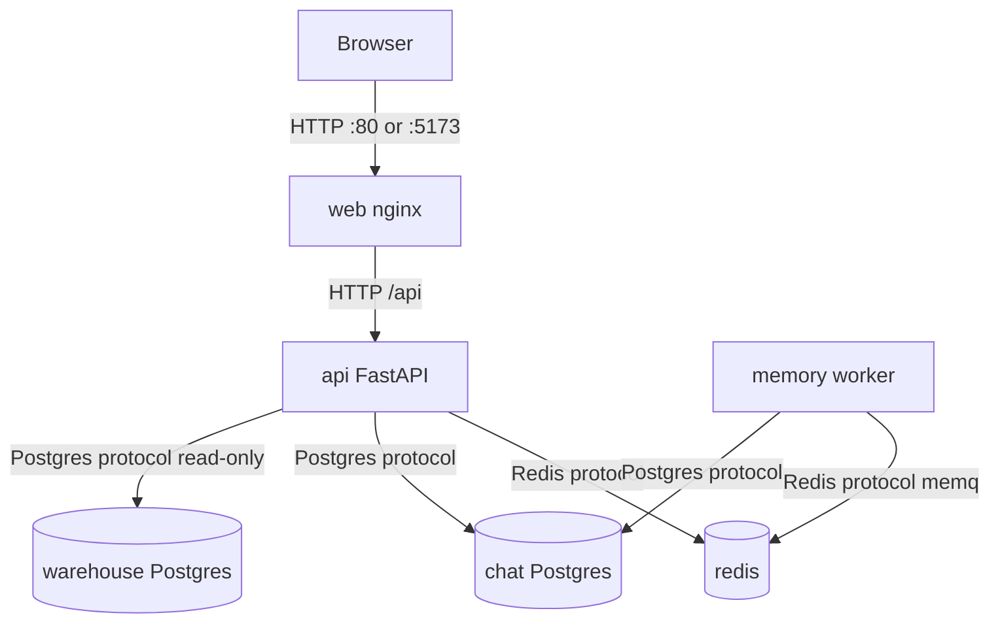

Source: [diagrams/system-context.mmd](diagrams/system-context.mmd). Edges: nginx proxy (`Frontend_Gerenal/nginx.conf:13-23`), Redis URL (`compose.yaml:20`), chat DB (`compose.yaml:14-19`), warehouse pool (`src/agent/sql/execute.py:61-67`), worker command (`compose.yaml:62-64`).

External calls leave `api` only. One of Anthropic or OpenAI is built, based on `LLM_PROVIDER` (`src/config/settings.py:90-91`, `src/agent/services/llm/providers.py:12-49`). Jev and Langfuse run only when their keys are set (`src/config/settings.py:107-117`, `src/agent/services/tracing.py:15-22`).

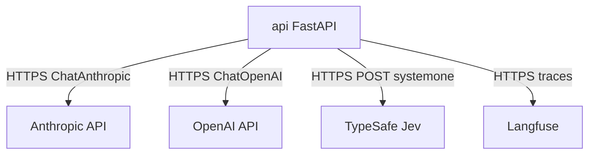

Source: [diagrams/external-deps.mmd](diagrams/external-deps.mmd). Jev URL is `https://api.typesafe.ai/v1/systemone` (`src/agent/services/typesafe.py:17`).

Deployment shape:

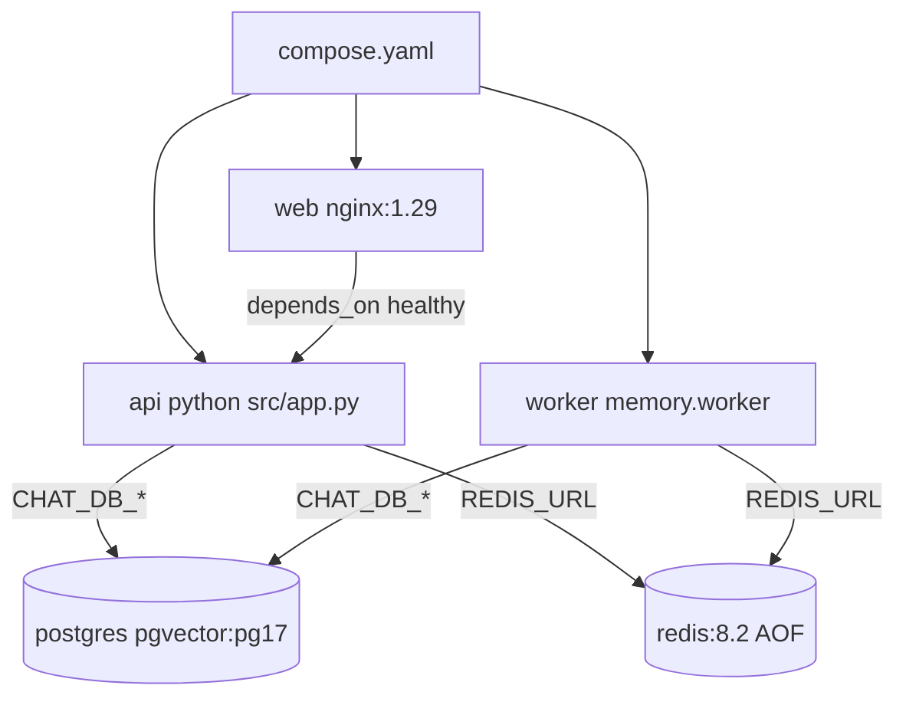

Source: [diagrams/deployment.mmd](diagrams/deployment.mmd). Images and health checks: `compose.yaml:31-106`, `Dockerfile:19-35`, `Frontend_Gerenal/Dockerfile:11-14`. The warehouse is not a Compose service. It is an external database named by `AUDIT_DB_*` (`src/config/settings.py:46-58`).

## 3. Technology stack

Versions for Python packages are the pins in `uv.lock`. Frontend versions are the resolved versions in `Frontend_Gerenal/package-lock.json`. Ranges in `package.json` are not repeated here.

| Layer | Technology | Version | Where configured |
| --- | --- | --- | --- |
| Language floor | Python | `>=3.12` | `pyproject.toml:5` |
| API image | `python:3.14-slim-bookworm` | 3.14 | `Dockerfile:19` |
| Dependency installer | uv image `ghcr.io/astral-sh/uv:python3.14-bookworm-slim` | 3.14 | `Dockerfile:3` |
| HTTP API | fastapi | 0.141.1 | `pyproject.toml:8`, `uv.lock` package `fastapi` |
| ASGI | starlette | 1.7.0 | `pyproject.toml:13`, `uv.lock` |
| Server | uvicorn | 0.53.0 | `pyproject.toml:9`, `src/app.py:100-104` |
| Models | pydantic | 2.13.5 | `pyproject.toml:10` |
| Env files | python-dotenv | 1.2.3 | `src/config/settings.py:14-16` |
| Catalog files | pyyaml | 6.0.3 | `pyproject.toml:12` |
| Agent graph | langgraph | 1.2.12 | `pyproject.toml:14`, `src/agent/graph/workflow.py:58` |
| LLM adapters | langchain | 1.4.2 | `pyproject.toml:15` |
| Anthropic adapter | langchain-anthropic | 1.7.3 | `pyproject.toml:16` |
| OpenAI adapter | langchain-openai | 1.6.6 | `pyproject.toml:22` |
| Traces | langfuse | 4.15.4 | `pyproject.toml:17`, `src/agent/services/tracing.py:15-22` |
| Redis checkpoints | langgraph-checkpoint-redis | 0.5.2 | `pyproject.toml:19`, `src/agent/checkpointer/saver.py:63-66` |
| Postgres checkpoint package | langgraph-checkpoint-postgres | 3.1.2 | `pyproject.toml:18`. Not used by `get_checkpointer` (`src/agent/checkpointer/saver.py:57-66`) |
| Checkpoint base | langgraph-checkpoint | 4.2.0 | transitive pin in `uv.lock` |
| Postgres driver | psycopg | 3.3.6 | `pyproject.toml:20`, `src/common/db/postgres.py` |
| SQL parse | sqlglot | 30.19.0 | `src/agent/sql/guard.py:186` |
| HTTP client | httpx | 0.28.1 | `src/agent/services/typesafe.py:40` |
| Password hash | bcrypt | 5.0.0 | `src/auth/passwords.py` |
| Access tokens | pyjwt | 2.15.0 | `src/auth/tokens.py:10`, algorithm `HS256` at line 20 |
| Redis client | redis | 8.1.0 | `src/common/cache/redis.py:37`, `src/agent/memory/storage/cache.py:72` |
| Tests | pytest | 9.1.1 | `pyproject.toml:30`, `pyproject.toml:34-36` |
| Chat database image | `pgvector/pgvector` | `pg17` | `compose.yaml:74` |
| Cache image | `redis` | `8.2` | `compose.yaml:94-95` |
| UI build | `node` | `22-alpine` | `Frontend_Gerenal/Dockerfile:4` |
| UI server | `nginx` | `1.29-alpine` | `Frontend_Gerenal/Dockerfile:11` |
| UI framework | react / react-dom | 18.3.1 | `Frontend_Gerenal/package-lock.json` `node_modules/react` |
| UI bundler | vite | 6.4.1 | `Frontend_Gerenal/package-lock.json` |
| UI language | typescript | 5.9.3 | `Frontend_Gerenal/package-lock.json` |
| UI state | zustand | 5.0.13 | `Frontend_Gerenal/src/store/authStore.ts:16` |
| UI validation | zod | 3.25.76 | `Frontend_Gerenal/package-lock.json` |
| UI tests | vitest | 3.2.4 | `Frontend_Gerenal/package.json:10` |
| Browser tests | `@playwright/test` | 1.60.0 | `Frontend_Gerenal/package-lock.json` |
| CSS | tailwindcss | 3.4.19 | `Frontend_Gerenal/package-lock.json` |
| Maps | leaflet | 1.9.4 | `Frontend_Gerenal/package-lock.json` |
| Markdown | marked | 17.0.5 | `Frontend_Gerenal/package-lock.json` |

There is no `.github/workflows` directory and no Terraform in the repo. Compose is the only deployment definition (`compose.yaml`).

## 4. Repository structure

Python imports use `PYTHONPATH=/app/src` in the image (`Dockerfile:22`) and `pythonpath = ["src"]` for pytest (`pyproject.toml:35`).

```text
.
├── src/                         Application code. Entry is src/app.py.
│   ├── agent/                   LangGraph turn, SQL, grounding, memory, prompts.
│   │   ├── checkpointer/        Redis checkpoint saver. Tests use memory.
│   │   ├── graph/               workflow.py compiles the graph. runner.py streams a turn.
│   │   ├── grounding/           In-memory name index loaded from the warehouse.
│   │   ├── memory/              Long-term memory, Redis hot keys, worker, HTTP export.
│   │   ├── prompts/             Prompt text for route, SQL, and reply.
│   │   ├── reply/               Structured reply streaming and maps.
│   │   ├── schemas/             Pydantic shapes for routes, SQL, and replies.
│   │   ├── services/            LLM clients, TypeSafe, Langfuse, stream events.
│   │   ├── sql/                 Guarded SELECT, listing search, cards, contact.
│   │   ├── states/              ChatState and ChatInput.
│   │   ├── tests/               Agent pytest modules.
│   │   └── validator/           Sanitizes router output. Not an HTTP router.
│   ├── auth/                    JWT, passwords, user repository, auth middleware.
│   ├── catalog/                 Domain YAML the SQL path loads. profiles/ holds profiler output.
│   ├── common/                  DB pools, cache, errors, middleware, rate limits, sessions.
│   ├── config/                  AppEnvironment and Config. settings.py reads the env.
│   ├── evals/                   Domain and SQL golden runners. Not started by the API.
│   ├── routes/                  HTTP routers: auth, chat, sessions, leads.
│   └── logs/                    Directory present beside the package. Eval JSON is written to repo logs/.
├── Frontend_Gerenal/            Vite React UI, its Dockerfile, and nginx.conf.
│   ├── src/api/                 fetch and SSE clients.
│   ├── src/components/          admin, auth, brand, chat, layout, leads, recommendations, ui.
│   ├── src/hooks/               useChat and usePropertyContact.
│   ├── src/store/               Zustand stores for auth, chat, prefs, focus.
│   ├── src/lib/                 Cards, voice client, markdown helpers.
│   ├── e2e/                     Playwright specs.
│   └── public/                  Static SVG assets.
├── docs/                        This set, plus docs/architecture/ from earlier work.
├── table schema/                Prior domain diagrams. No Python file imports this path.
├── logs/                        Rotating app.log when LOG_TO_FILE is true.
├── compose.yaml                 api, web, worker, postgres, redis, and the jobs profile.
├── Dockerfile                   API and worker image.
├── pyproject.toml               Backend dependencies and pytest paths.
├── uv.lock                      Pinned backend versions.
├── example.env                  Settings template named by README.
└── README.md                    Local and Compose run steps.
```

`playground.ipynb` and `testquries.md` sit at the repo root. They are not imported by `create_app` (`src/app.py:29-54`).

## 5. End-to-end workflows

The chat graph is one `StateGraph` named by `build_chat_graph` (`src/agent/graph/workflow.py:47-111`). Fifteen node functions are registered at lines 59-76. `stream_turn` is what `POST /api/chat` calls (`src/routes/chat.py:52-63`, `src/agent/graph/runner.py:54-132`).

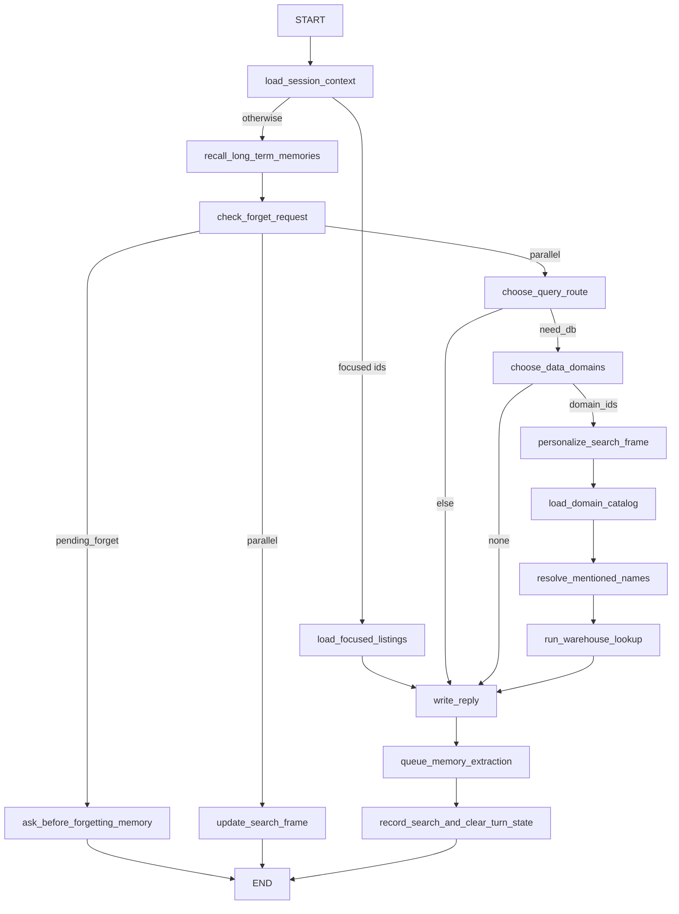

Source: [diagrams/chat-graph.mmd](diagrams/chat-graph.mmd). Branch functions: `next_step_after_session_context` (`src/agent/graph/nodes/focus.py:49-54`), `next_step_after_forget_check` (`src/agent/graph/nodes/memory.py:191-199`), `next_step_after_query_route` (`src/agent/graph/nodes/routing.py:130-134`), `next_step_after_domain_choice` (`src/agent/graph/nodes/routing.py:137-141`).

`Route` values are `direct_answer`, `need_db`, and `out_of_scope` (`src/agent/enums/routing.py:4-9`).

### 5.1 Warehouse lookup turn

Trigger: `POST /api/chat` whose query route is `need_db` and whose domain route has `domain_ids` (`src/agent/graph/nodes/routing.py:130-141`). Preconditions: the API process is up, Redis is reachable outside tests (`src/agent/checkpointer/saver.py:60-61`), and the warehouse credentials in `AUDIT_DB_*` can run `SELECT`.

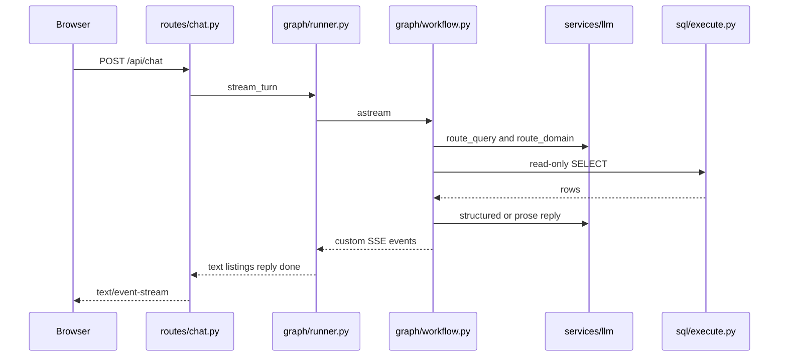

| Step | Component | File:lines | What happens | Data in → out |
| --- | --- | --- | --- | --- |
| 1 | Rate limit | `src/routes/chat.py:32-38` | Visitor 20/60s or registered 60/60s | caller → allow or `RateLimited` |
| 2 | Thread id | `src/routes/chat.py:39-42` | `thread_id` or `session_id` or a new hex. Sidebar row written | message, user id → thread id |
| 3 | SSE open | `src/routes/chat.py:49-77` | First chunk is the comment `: ok` | none → `text/event-stream` |
| 4 | Resume check | `src/agent/graph/runner.py:85-94` | If the checkpoint is interrupted, input is `Command(resume=message)` | message → graph input |
| 5 | Session context | `src/agent/graph/nodes/memory.py:29-45` | Loads `wm:{thread}` and `profile:{user}` | thread id → `query_frame`, `profile` |
| 6 | Recall | `src/agent/graph/nodes/memory.py:48-62` | Keyword recall from the memory store | user id, text → `memory_context` |
| 7 | Forget check | `src/agent/graph/nodes/memory.py:65-75` | A forget phrase sets `pending_forget` and leaves this path | text → `pending_forget` or null |
| 8 | Parallel | `src/agent/graph/workflow.py:86-93` | `choose_query_route` and `update_search_frame` run in one step. The frame edge ends | text → `query_route`, `query_frame` |
| 9 | Query route | `src/agent/graph/nodes/routing.py:29-76` | Router model. Invalid output becomes `need_db` at confidence 0.3 | text → `QueryRoute` |
| 10 | Domains | `src/agent/graph/nodes/routing.py:79-127` | `refine` reuses the last domains. Otherwise Jev or the router model | route → `domain_ids`, `recipe_id` |
| 11 | Personalize | `src/agent/graph/nodes/memory.py:121-143` | Copies intent into the frame and applies saved preferences | frame, memories → `memory_block` |
| 12 | Catalog | `src/agent/graph/nodes/catalog.py:13-29` | Renders YAML for the chosen domains | domain ids → `catalog_context` |
| 13 | Grounding | `src/agent/graph/nodes/lookup.py:36-85` | Waits up to 30s for the first index. Unready index keeps names unmatched | names → `grounding` |
| 14 | Lookup | `src/agent/graph/nodes/lookup.py:88-120` | Listing intents with filters use code SQL. Other lookups use a recipe, then a draft | state → `sql_result`, `listing_ids` |
| 15 | Cards | `src/agent/graph/nodes/lookup.py:111-116` | Fills cards and emits SSE `listings` | ids → cards |
| 16 | Reply | `src/agent/graph/nodes/reply.py:103-233` | Status `rows` or `empty` tries a structured reply. Failures use prose or a fixed line | rows → assistant text |
| 17 | Queue | `src/agent/graph/nodes/memory.py:146-188` | `XADD` to `memq` unless memory is disabled or the cache is missing | frame → Redis stream entry |
| 18 | Turn end | `src/agent/graph/nodes/turn_end.py:24-75` | Saves `last_need_db` and working memory. Clears catalog, cards, and rows from the checkpoint | state → Redis checkpoint |
| 19 | Done | `src/agent/graph/runner.py:114-122` | SSE `done` with `thread_id`, `route`, `paused` | state → done event |

Warehouse execution sets `transaction_read_only`, `statement_timeout` (`SQL_TIMEOUT_MS`, default 15000), and `search_path` (`src/agent/sql/execute.py:71-88`, `src/config/settings.py:57-58`). `prepare_select` limits the statement to `SQL_ROW_CAP + 1` rows (`src/agent/sql/guard.py:350-361`). `fetch_readonly` returns at most `SQL_ROW_CAP` of those rows and sets `truncated` when more were fetched (`src/agent/sql/execute.py:95-100`).

Listing search (`src/agent/sql/lookup.py:72-141`): one code-written query. On `SqlFailed`, if text search was used, it retries once without the text query (lines 101-119).

Drafted SQL (`src/agent/sql/lookup.py:144-304`): at most two attempts (`MAX_ATTEMPTS = 2`, line 56). A bound recipe runs first (lines 166-172). Otherwise the model drafts SQL, `prepare_select` allows one catalog `SELECT` (`src/agent/sql/guard.py:180-213`), filter values may be rewritten (lookup lines 232-238), and a blended average on attempt 1 is rejected (lines 239-251). Empty rows and a single all-zero row set `previous_error` for attempt 2 (lines 291-295). A later hard failure keeps an earlier row result (lines 297-298).

Latency: steps 9, 10, 14, and 16 call a model or the warehouse. Step 13 can wait 30 seconds on a cold start (`src/agent/graph/nodes/lookup.py:33-47`). Each node logs `node.timing` (`src/agent/graph/workflow.py:114-131`).

Errors the user sees:

- Rate limit: Problem Details from `RateLimited`, before the stream starts (`src/common/middleware/rate_limit.py:41-46` for the default ceiling; chat uses its own rule at `src/routes/chat.py:32-33`).
- Stream exception: SSE `error` with `I couldn't complete that reply.` (`src/routes/chat.py:65-67`, `src/routes/chat.py:93-94`).
- Empty lookup: `I couldn't find anything matching that. Want me to widen the area or the price range?` (`src/agent/sql/lookup.py:57-59`, published at `src/agent/graph/nodes/reply.py:195-197`).
- Failed lookup after the prose fallback fails: `I couldn't work that out this time. Ask me again, or try one part of it at a time.` (`src/agent/sql/lookup.py:60-62`, `src/agent/graph/nodes/reply.py:236-262`).
- Structured reply fallback: `Sorry, I couldn't put that answer together just now. Could you ask me again?` (`src/agent/services/llm/fallbacks.py:27-29`).

### 5.2 Direct answer, out of scope, and no domain

Trigger: `choose_query_route` returns something other than `need_db`, or `choose_data_domains` returns no `domain_ids` (`src/agent/graph/nodes/routing.py:130-141`).

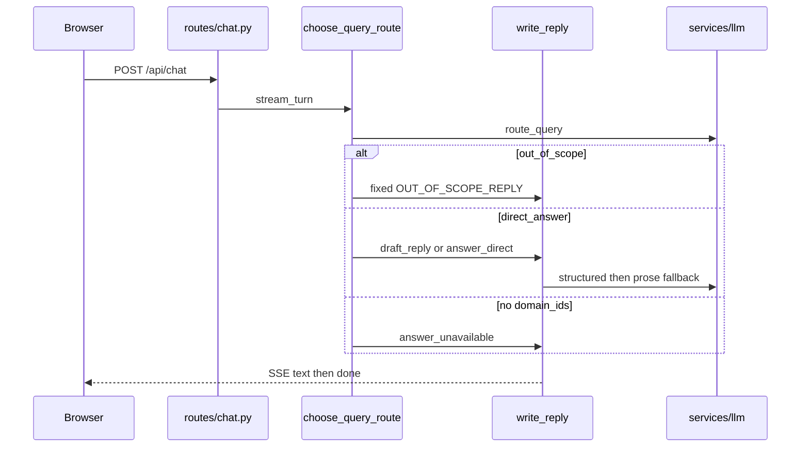

| Step | Component | File:lines | What happens | Data in → out |
| --- | --- | --- | --- | --- |
| 1 | Route | `src/agent/graph/nodes/routing.py:66-76` | Non-database routes clear `domain_route` | route → state |
| 2 | Out of scope | `src/agent/graph/nodes/reply.py:65-69` | Fixed text. No model call | none → `That's outside what I can do...` (`reply.py:44-46`) |
| 3 | Direct | `src/agent/graph/nodes/reply.py:71-94` | Structured reply. If that returns none, streamed `answer_direct` | message → text |
| 4 | No domains | `src/agent/graph/nodes/reply.py:96-98`, `308-323` | `answer_unavailable` prose | message → text |
| 5 | Router fallback | `src/agent/services/llm/fallbacks.py:10-15` | Invalid router JSON becomes `need_db`, so this section is skipped and section 5.1 runs | bad JSON → `need_db` |
| 6 | Domain fallback | `src/agent/services/llm/fallbacks.py:17-22` | Invalid domain JSON has empty `domain_ids`, so step 4 runs | bad JSON → unavailable prose |

Latency: the router call and, for direct answers, the reply call. Out of scope does not call the answer model (`src/agent/graph/nodes/reply.py:65-66`).

### 5.3 Focused listings

Trigger: `ChatRequest.focused_property_ids` is non-empty (`src/routes/schemas/chat.py:24`, max 8 at `src/agent/sql/listing_details.py:28`). `next_step_after_session_context` sends the turn to `load_focused_listings` (`src/agent/graph/nodes/focus.py:49-54`). Routing, grounding, and warehouse text-to-SQL do not run (`src/agent/graph/workflow.py:84`).

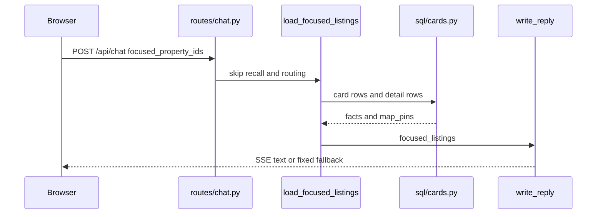

| Step | Component | File:lines | What happens | Data in → out |
| --- | --- | --- | --- | --- |
| 1 | Input | `src/agent/graph/runner.py:135-148` | `focused_property_ids` is always set, including an empty list, so a later turn leaves listing mode | ids → graph input |
| 2 | Load | `src/agent/graph/nodes/focus.py:20-46` | Fixed card and detail statements. `query_route` is cleared | ids → facts, map pins |
| 3 | Reply | `src/agent/graph/nodes/reply.py:265-305` | `draft_listing_reply` when facts exist | facts → structured text |
| 4 | Missing facts | `src/agent/graph/nodes/reply.py:293-294` | Fixed line when the model returns none, or when no listings were found | empty → the strings at `reply.py:40-49` |

Latency: two warehouse reads, then one reply model call. The user sees `I couldn't find the listings you picked...` when the list is empty (`src/agent/graph/nodes/reply.py:40-43`) or `I couldn't pull those listing details together just now...` when facts exist but the reply fails (`reply.py:47-49`).

### 5.4 Forget confirmation

Trigger: `is_forget_request` is true inside `check_forget_request` (`src/agent/graph/nodes/memory.py:65-75`). The node returns before `choose_query_route`.

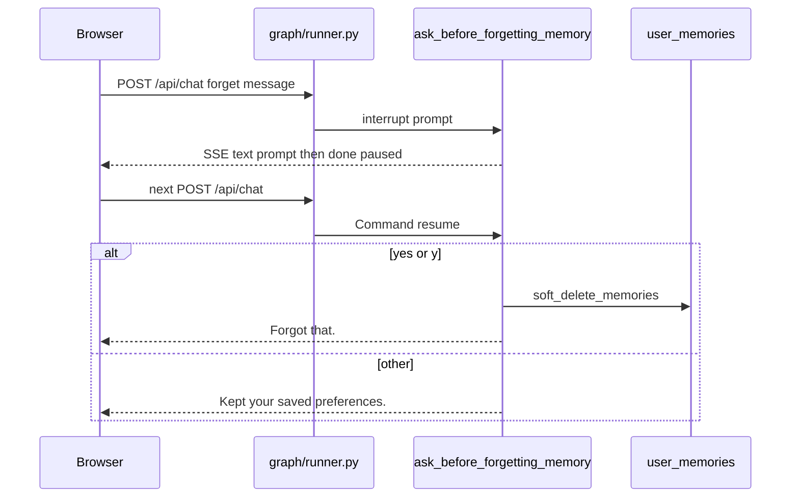

| Step | Component | File:lines | What happens | Data in → out |
| --- | --- | --- | --- | --- |
| 1 | Detect | `src/agent/graph/nodes/memory.py:65-75` | Builds `pending_forget` from the message | text → prompt |
| 2 | Interrupt | `src/agent/graph/nodes/memory.py:97-103` | `interrupt` pauses the graph | prompt → checkpoint interrupt |
| 3 | Stream | `src/agent/graph/runner.py:106-122` | Interrupt value is an SSE `text` event. `done.paused` is true | interrupt → text, `paused: true` |
| 4 | Resume | `src/agent/graph/runner.py:85-88` | The next message on the same thread is `Command(resume=message)` | text → resume value |
| 5 | Yes | `src/agent/graph/nodes/memory.py:104-114` | `yes` or `y` soft-deletes. SSE text is `Forgot that.` | yes → deleted rows |
| 6 | No | `src/agent/graph/nodes/memory.py:115-118` | Any other text. SSE text is `Kept your saved preferences.` | other → no write |

The graph edge from this node goes to `END` (`src/agent/graph/workflow.py:91`). No warehouse lookup runs. Latency is the interrupt wait, which is the user's next request, not a timer.

### 5.5 Auth lifecycle and caller identity

Trigger: the auth form, or any HTTP request. Middleware runs on every HTTP request. Sign-in routes are the five handlers in `src/routes/auth.py`.

Request order, outer to inner, because the last `add_middleware` runs first (`src/app.py:55-68`): CORS, `RequestIdMiddleware`, `AuthMiddleware`, `CallerMiddleware`, `RateLimitMiddleware`.

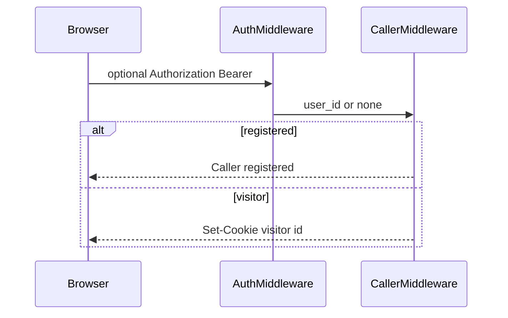

| Step | Component | File:lines | What happens | Data in → out |
| --- | --- | --- | --- | --- |
| 1 | CORS | `src/app.py:23-26`, `62-68` | Origins `http://localhost:5173` and `http://127.0.0.1:5173` only | Origin → allow or browser block |
| 2 | Request id | `src/common/middleware/request_id.py:33-39` | Reuses a safe `X-Request-ID` or mints one | header → `request.state.request_id` |
| 3 | Bearer | `src/auth/middleware.py:40-50` | A valid token sets `user_id`. A bad token stores `auth_error` and does not reject the request | header → user id or error |
| 4 | Caller | `src/common/middleware/caller.py:22-30`, `76-90` | Registered if `user_id` is set. Otherwise cookie `VISITOR_COOKIE_NAME`, header `X-Visitor-ID`, or a new id. Visitors get `Set-Cookie` | token or cookie → `Caller` |
| 5 | Register | `src/routes/auth.py:37-43`, `src/auth/service.py:18-25` | 5 attempts per hour per IP. Inserts `chatbot_users` and a refresh hash. Status 201 | name, email, password, phone → `AuthResponse` |
| 6 | Login | `src/routes/auth.py:46-58`, `src/auth/service.py:28-32` | Failure-only counters. Wrong password raises `InvalidCredentials` | email, password → `AuthResponse` |
| 7 | Refresh | `src/auth/service.py:35-48` | One rotation wins. Old hash is revoked. Unknown token raises `InvalidToken` | refresh token → new pair |
| 8 | Logout | `src/auth/service.py:51-52` | Revokes the refresh hash. Status 204. No bearer required | refresh token → empty body |
| 9 | Me | `src/routes/auth.py:73-76` | `require_user_id`. Missing user raises `InvalidToken` | bearer → `UserResponse` |

Password rules (`src/routes/schemas/auth.py:13-17`, `54-63`): at least 8 characters, one uppercase letter, one digit, at most 72 bytes (`src/auth/passwords.py:11`). Email max 254 (`auth.py:14`).

The UI stores the access token in memory and the refresh token in `localStorage['propqa_refresh_token']` (`Frontend_Gerenal/src/store/authStore.ts:10-13`). Guest ids are `anon-` plus a UUID (`authStore.ts:65-71`, prefix checked at `src/common/session/id_validation.py:8`). First visit opens the auth gate (`Frontend_Gerenal/src/App.tsx:212-219`). `/dashboard` without a signed-in user is pushed back to `/` (`App.tsx:224-233`).

`POST /api/sessions/{session_id}/claim` is the only other route that calls `require_user_id` (`src/routes/sessions.py:88-96`). It moves a sidebar row when `guest_user_id` starts with `anon-`.

Errors: validation failures become Problem Details (`src/common/http/exception_handlers.py:33-39`). Duplicate email raises `EmailTaken` from the unique index (`src/auth/storage/postgres.py:74-75`). Deployed processes refuse to start without a JWT key of at least 32 bytes (`src/auth/tokens.py:28-41`, called at `src/app.py:39-40`). Development with an empty key uses a random per-process key (`tokens.py:42-45`), so tokens die on restart.

### 5.6 Sessions, turns, and forget

Trigger: the sidebar. List and restore do not check the bearer token. The owner id is the `user_id` query or the id stored when chat started.

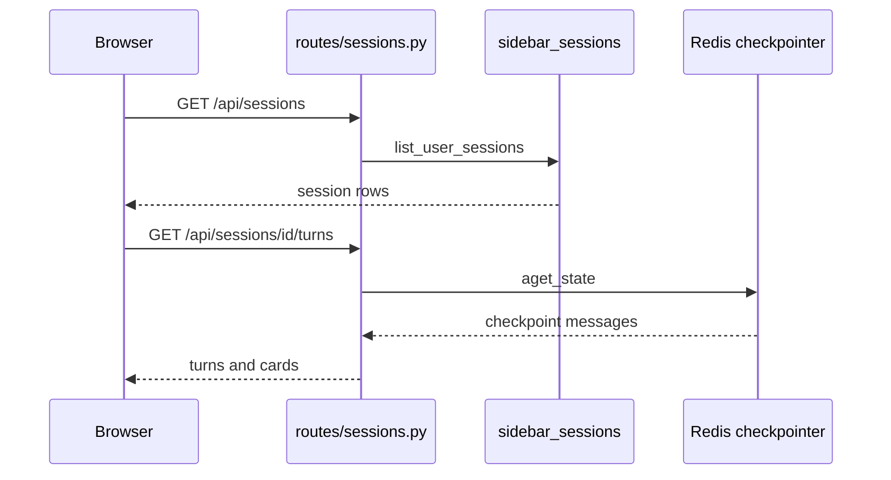

| Step | Component | File:lines | What happens | Data in → out |
| --- | --- | --- | --- | --- |
| 1 | Record | `src/routes/chat.py:42`, `src/common/session/sidebar_sessions.py:14-30` | Each chat message upserts `chat:sidebar:{user}` and `chat:session-owner:{session}`. TTL 7 days. Cap 50 | user, thread, message → row |
| 2 | New | `src/routes/sessions.py:34-37` | Returns a new UUID. The body is discarded. `carried_over` is always `[]` | body ignored → `session_id` |
| 3 | List | `src/routes/sessions.py:40-42` | `limit` default 30 | user id → rows |
| 4 | Turns | `src/routes/sessions.py:45-62` | Checkpoint read. Invalid id is 404. Read failure is 503 | session id → turns, messages |
| 5 | Cards | `src/routes/sessions.py:134-153` | One warehouse read fills `cards` from stored listing ids | ids → cards |
| 6 | Forget one | `src/routes/sessions.py:71-76`, `178-184` | Drops the sidebar row and `delete_thread`. Missing row is 404 | session id → `forgotten` |
| 7 | Forget many | `src/routes/sessions.py:65-68` | Same delete. Returns only ids that were removed | ids → `forgotten` |
| 8 | Forget all | `src/routes/sessions.py:79-85`, `201-209` | Also deletes every memory cluster for `body.user_id` | user id → memories deleted |
| 9 | Quota | `src/routes/sessions.py:99-102` | After id validation, returns `used: 0`, `limit: 100`, `remaining: 100`, `exhausted: false` | session id → constants |
| 10 | Context | `src/routes/sessions.py:105-113` | Returns zeros. `compact` calls the same function | session id → zeros |

`knowledge` and `summary` in the turns payload are always `{}` and `""` (`src/routes/sessions.py:56-61`).

### 5.7 Preferences

Trigger: `GET`, `POST`, or `DELETE /api/preferences`. Storage is the shared cache key `chat:preferences:{user_id}` with the 7-day session TTL (`src/common/session/preferences.py:9-29`). The Redis key is prefixed with `CACHE_KEY_PREFIX` (`src/common/cache/factory.py:20-23`, `src/common/cache/redis.py:42-43`).

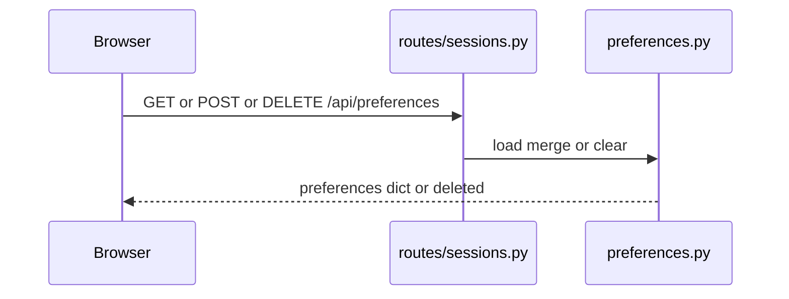

| Step | Component | File:lines | What happens | Data in → out |
| --- | --- | --- | --- | --- |
| 1 | Get | `src/routes/sessions.py:116-118` | Invalid `user_id` is 400 | user id → dict or null |
| 2 | Save | `src/routes/sessions.py:121-124` | Shallow merge into the stored dict | dict → merged dict |
| 3 | Delete | `src/routes/sessions.py:127-131` | `session_id` is ignored | user id → `deleted` |

No bearer check. Latency is one Redis round trip.

### 5.8 Property contact

Trigger: `GET /api/leads/property-contact?property_id=`. `property_id` must be greater than 0 (`src/routes/leads.py:16-17`).

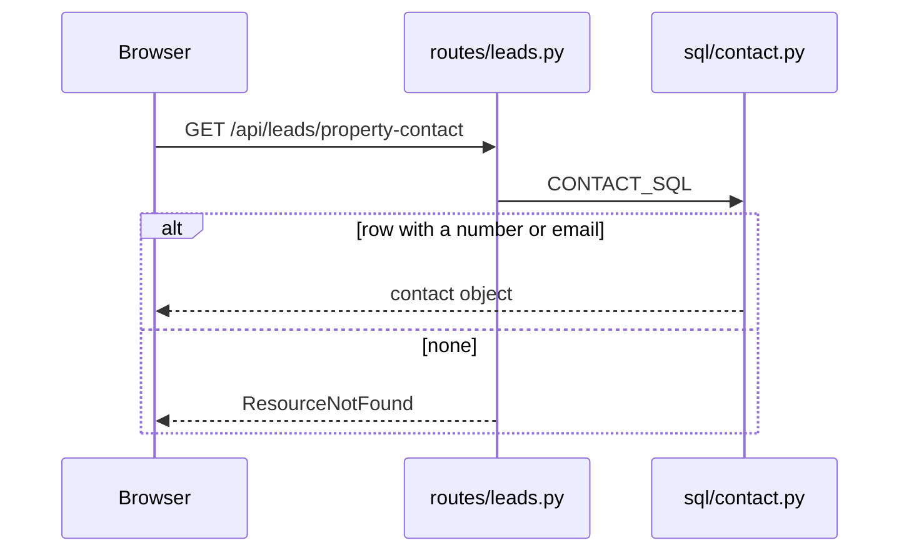

| Step | Component | File:lines | What happens | Data in → out |
| --- | --- | --- | --- | --- |
| 1 | SQL | `src/agent/sql/contact.py:9-35` | Active, non-deleted `public.properties` row joined to `public.users` | property id → row or none |
| 2 | Shape | `src/agent/sql/contact.py:49-82` | Agency phone or email wins. Otherwise listing proxy, phone, or agent | row → contact dict |
| 3 | Miss | `src/routes/leads.py:24-25` | `ResourceNotFound` with `No contact available for this listing.` | none → 404 problem |
| 4 | DB error | `src/routes/leads.py:21-23` | `SqlFailed` becomes `DatabaseFailure` | exception → `Contact details are unavailable right now.` |

Contact keys: `property_id`, `agent_id`, `agent_name`, `company_name`, `phone`, `mobile`, `whatsapp`, `email`, `verification_status`, `contact_source` (`agency` or `listing_agent`) (`src/agent/sql/contact.py:55-82`).

### 5.9 Memory export and delete

Trigger: `GET` or `DELETE /api/users/{user_id}/memory`. The path `user_id` is not compared to the bearer token (`src/agent/memory/routes/user_memory.py:12-23`).

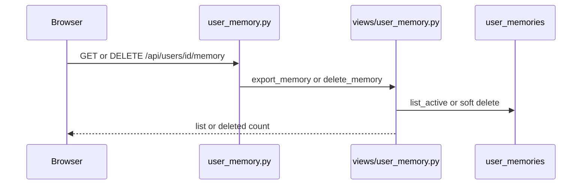

| Step | Component | File:lines | What happens | Data in → out |
| --- | --- | --- | --- | --- |
| 1 | Store missing | `src/agent/memory/views/user_memory.py:12-16` | 503 `memory store is not configured` | none → 503 |
| 2 | Export | `src/agent/memory/maintenance/privacy.py:63-78` | Active rows. Fields: `id`, `content`, `provenance`, `confidence`, `created_at`, `type`, `cluster` | user id → list |
| 3 | Delete args | `src/agent/memory/views/user_memory.py:28-31` | 400 if both query params are missing, or if `cluster` is unknown | query → error or proceed |
| 4 | Delete | `src/agent/memory/views/user_memory.py:32-35` | Soft delete. Body `{"status":"deleted","count":n}` | cluster or memory id → count |

Clusters are the eight `MemoryCluster` values (`src/agent/enums/memory.py:32-41`, `63`).

### 5.10 Memory worker

Trigger: process start `python -m agent.memory.worker` (`src/agent/memory/worker.py:1-6`, `compose.yaml:62-64`). Jobs are enqueued by `queue_memory_extraction` (`src/agent/graph/nodes/memory.py:176-187`).

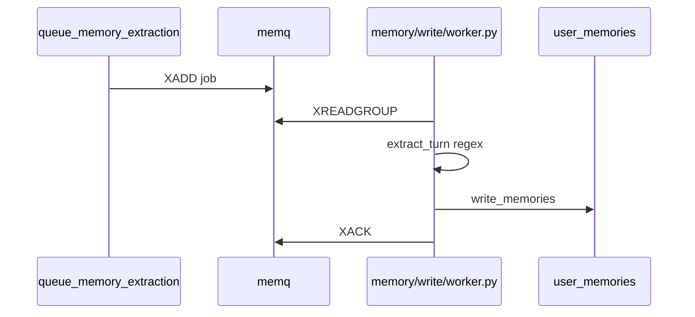

| Step | Component | File:lines | What happens | Data in → out |
| --- | --- | --- | --- | --- |
| 1 | Enqueue | `src/agent/memory/storage/cache.py:99-106` | Stream `memq`, maxlen 10000 approximate. No TTL in this code | job dict → entry id |
| 2 | Read | `src/agent/memory/storage/cache.py:108-124` | Group `memory-worker`, consumer `worker-1`, block 2000 ms, count 10 | stream → jobs |
| 3 | Skip | `src/agent/memory/write/worker.py:17-24` | Empty user id or `memory_enabled` false returns no writes | job → `[]` |
| 4 | Extract | `src/agent/memory/write/worker.py:25-28` | `extract_turn` is regex, then cluster allow-list | job → memory ops |
| 5 | Write | `src/agent/memory/write/worker.py:28-29` | Upsert and an `extracted` event | ops → row ids |
| 6 | Ack | `src/agent/memory/write/worker.py:53-59` | Failures are logged and not acked, so the entry stays pending | exception → log |
| 7 | Inline consolidate | `src/agent/memory/write/worker.py:30-31` | Every 20th `extracted` event for that user calls `consolidate_user` | count → consolidate |

Without this process, jobs stay on `memq` (`compose.yaml:60-61`). Chat still completes, because enqueue is after the reply (`src/agent/graph/workflow.py:108-110`).

### 5.11 Consolidate job

Trigger: `python -m agent.memory.worker --consolidate` (`src/agent/memory/write/worker.py:62-67`). Compose starts it only with profile `jobs` (`compose.yaml:66-71`). The module docstring says nightly (`src/agent/memory/maintenance/consolidate.py:1`). No scheduler in this repo calls it. The worker also calls `consolidate_user` every 20 extractions (section 5.10 step 7).

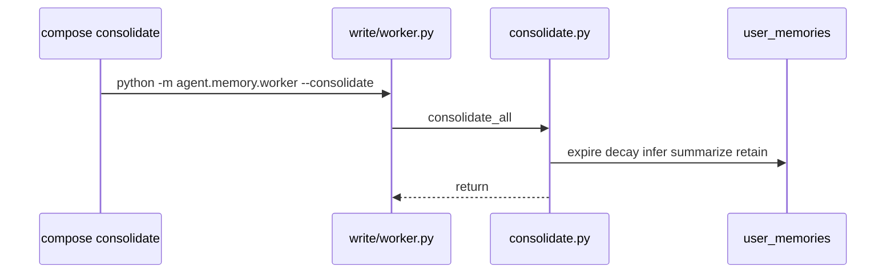

| Step | Component | File:lines | What happens | Data in → out |
| --- | --- | --- | --- | --- |
| 1 | All users | `src/agent/memory/maintenance/consolidate.py:17-20` | One pass per user id the repository lists | none → per-user call |
| 2 | Expire | `consolidate.py:35-39` | Active rows past `expires_at` become `expired` | rows → status |
| 3 | Supersede | `consolidate.py:212-229` | Older episodic rows that match a semantic key become `superseded` | rows → status |
| 4 | Cache | `consolidate.py:32` | `invalidate_user_memory_cache` | user id → Redis deletes |

The process exits after one pass (`worker.py:65-67`). `restart: "no"` (`compose.yaml:70`).

### 5.12 Grounding index load

Trigger: `main` calls `load_in_background` before uvicorn serves (`src/app.py:98-99`). A later `get` starts another load when the copy is older than `GROUNDING_REFRESH_SECONDS` (default 3600) (`src/agent/grounding/index.py:141-146`, `src/config/settings.py:61`).

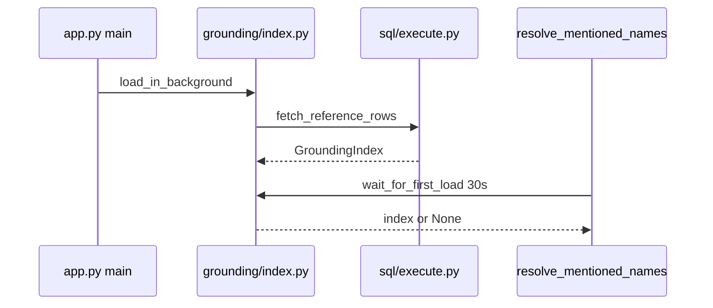

| Step | Component | File:lines | What happens | Data in → out |
| --- | --- | --- | --- | --- |
| 1 | Thread | `src/agent/grounding/index.py:161-168` | Daemon thread named `grounding-load` | none → background load |
| 2 | Query | `src/agent/sql/execute.py:46-58` | Reference reads use a 60s timeout and a 500000 row cap | SQL → rows |
| 3 | Failure | `src/agent/grounding/index.py:170-176` | Logged as `grounding.load_failed`. The previous copy stays | exception → warning |
| 4 | Wait | `src/agent/graph/nodes/lookup.py:31-47` | First turn waits up to 30s. None means names stay unmatched | timeout → `grounding` or unmatched names |

Latency: the first chat turn can block up to 30 seconds on this wait. Later refreshes do not block (`src/agent/graph/nodes/lookup.py:31-32`).

### 5.13 CLI tools that are not request paths

These are not mounted on the API.

| Command | File:lines | What it does |
| --- | --- | --- |
| `python src/app.py` | `src/app.py:90-108` | Logs, grounding thread, uvicorn |
| `python -m agent.memory.worker` | `src/agent/memory/write/worker.py:62-68` | Blocks on `memq` |
| `python -m agent.memory.worker --consolidate` | `src/agent/memory/write/worker.py:65-67` | One consolidation pass |
| `python -m evals.run_domain_eval` | `src/evals/run_domain_eval.py` | Domain-router golden cases |
| `python -m evals.run_sql_eval` | `src/evals/run_sql_eval.py:66` | Writes `logs/sql_eval_<timestamp>.json` |
| `python -m catalog.profiler` | `src/catalog/profiler.py` | Writes profile YAML under `src/catalog/profiles/` |

## 6. Component deep dives

### 6.1 `create_app` and middleware

Responsibility: build the FastAPI app, refuse to start in a deployed environment without a usable JWT key, mount routers, and register middleware (`src/app.py:29-87`).

Public interface: `create_app` returns the app. `main` calls uvicorn (`src/app.py:90-104`).

Internal flow: exception handlers, then five routers at `/api`, then middleware. Injected `app.state` fields (`chat_graph`, `chat_models`, `sql_runner`, listing loaders, `contact_loader`, `user_repository`) exist so tests can replace them (`src/app.py:42-48`). Production `main` leaves them unset, so routes use the process defaults.

State owned: none beyond `app.state` and the process-wide checkpointer, cache, and pools those defaults open.

Depends on: `auth.tokens.signing_key`, the five routers, and the middleware classes.

### 6.2 Chat graph

Responsibility: one turn of classification, optional lookup, reply, and memory enqueue (`src/agent/graph/workflow.py:47-56`).

Public interface: `build_chat_graph`, `get_chat_graph` (`workflow.py:47`, `136-147`), `run_turn`, `stream_turn` (`src/agent/graph/runner.py:20`, `54`).

State owned: `ChatState` (`src/agent/states/chat.py:11-44`). Caller input is `ChatInput`: `messages`, `session_profile`, `focused_property_ids` (`chat.py:47-52`). The checkpointer keeps the rest.

`get_chat_graph` opens the memory cache and the long-term store outside tests (`workflow.py:141-145`). The store is `PropQAMemoryStore(repository)` with the default `embed=None` (`src/agent/memory/session/backends.py:51-68`, `src/agent/memory/storage/langgraph_store.py:31-39`).

### 6.3 LLM calls

Responsibility: one provider for the router model, the answer model, and the SQL model (`src/agent/services/llm/providers.py`).

Public interface: structured calls go through `invoke_structured_with_fallback` (`src/agent/services/llm/calls.py:21-28`): one invoke, one retry, then the static fallback in `fallbacks.py`. Permanent 4xx other than 408, 409, and 429 skip the retry (`src/agent/services/llm/calls.py:49`, `65-73`).

There is no cross-vendor fallback. `LLM_PROVIDER` must be `anthropic` or `openai` when models are built.

### 6.4 SQL guard and warehouse

Responsibility: run one read-only `SELECT` (`src/agent/sql/execute.py:29-43`). `prepare_select` rejects empty SQL, multiple statements, non-SELECT, tables outside the loaded catalog, comparisons with no column, and unparenthesized `AND`/`OR` mixes (`src/agent/sql/guard.py:180-213`).

State owned: connection pool name `warehouse` (`execute.py:61-67`).

### 6.5 Catalog

Responsibility: ten domain files named by `src/catalog/domains/index.yaml`. `load_domain_catalog` renders only the chosen ids (`src/agent/graph/nodes/catalog.py:13-29`). The router is told to load the index first (`index.yaml:1-3`).

The ten ids and the `table_count` field in the index: listings 25, transactions 10, locations 23, developers 18, schools 13, rta 32, amenities 5, agencies 6, regulations 2, market 29. The `qualified_name` lines in `listings.yaml` number 26. That mismatch is recorded in section 12. The full name list is in [DATA_MODEL.md](DATA_MODEL.md).

### 6.6 Auth

Responsibility: bcrypt passwords, HS256 access tokens, opaque refresh tokens stored as hashes (`src/auth/service.py`, `src/auth/tokens.py:20-21`, `src/auth/storage/postgres.py:30-37`).

Public interface: the five routes in section 5.5. `require_user_id` (`src/auth/middleware.py:33-37`).

State owned: `chatbot_users` and `chatbot_refresh_tokens`.

### 6.7 Sessions and cache

Responsibility: sidebar list and buyer-preference blob in the shared cache (`src/common/session/sidebar_sessions.py`, `src/common/session/preferences.py`). Turn text comes from the LangGraph checkpoint (`src/routes/sessions.py:45-54`).

State owned: Redis keys `chat:sidebar:{user}`, `chat:session-owner:{session}`, `chat:preferences:{user}`, prefixed by `CACHE_KEY_PREFIX` (`src/common/cache/redis.py:42-43`).

### 6.8 Memory

Responsibility: hot keys in Redis, durable rows in chat Postgres, extraction off the request (`src/agent/memory/storage/cache.py:1`, `src/agent/memory/storage/postgres.py:1-3`).

Public interface: graph nodes in `src/agent/graph/nodes/memory.py`, HTTP in `src/agent/memory/routes/user_memory.py`, CLI in `src/agent/memory/worker.py`.

Hot keys, not prefixed by `CACHE_KEY_PREFIX`: `wm:{thread}` 2 hours, `profile:{user}` 15 minutes, `recall:{user}:{digest}` 5 minutes, stream `memq` (`src/agent/memory/storage/cache.py:11-16`).

### 6.9 Frontend shell

Responsibility: chat UI and a `/dashboard` view. There is no React Router. `window.location.pathname === "/dashboard"` selects the dashboard (`Frontend_Gerenal/src/App.tsx:57-66`). Dev server proxies `/api` and `/ws/chat` to `127.0.0.1:8000` (`Frontend_Gerenal/vite.config.ts:29-40`). nginx does the same for `/api/` and `/ws/` (`Frontend_Gerenal/nginx.conf:13-33`). The API sets `ws_mounted` to false (`src/app.py:80`).

## 7. Data flow and persistence

| Store | What is written | What is read | Consistency |
| --- | --- | --- | --- |
| Warehouse Postgres | Nothing in this repo. `SET LOCAL transaction_read_only` (`src/agent/sql/execute.py:86`) | Lookups, cards, contact, grounding | One transaction per statement. No cross-statement transaction in the graph |
| Chat Postgres `chatbot_users` | `INSERT` on register (`src/auth/storage/postgres.py:66-72`) | By id and email | Unique index on `lower(email)` (lines 27-28) |
| Chat Postgres `chatbot_refresh_tokens` | Insert, revoke, delete stale (`postgres.py:91-150`) | `UPDATE ... RETURNING` on rotate (lines 104-111) | Rotate is one transaction so one of two concurrent refreshes wins (lines 99-102) |
| Chat Postgres memory tables | Worker and forget paths | Recall and export | `consolidate_user` uses `repository.transaction()` (`src/agent/memory/maintenance/consolidate.py:26`) |
| Redis checkpoints | Every graph superstep via `RedisCheckpointSaver` | Next turn and `GET .../turns` | TTL 24 hours, refresh on read (`src/agent/checkpointer/saver.py:21-22`, `63-65`). Key names are inside the LangGraph Redis saver |
| Redis shared cache | Sidebar, preferences, rate-limit counters | Those readers | TTL on set. Rate-limit key `ratelimit:{scope}:{identity}:{window}` (`src/common/ratelimit/limiter.py:102-103`) |
| Redis memory cache | Working memory, profile, recall, `memq` | Graph and worker | Separate client. No `CACHE_KEY_PREFIX` |
| Process memory | `GroundingIndex` | Name resolution | Replaced as a whole on load (`src/agent/grounding/index.py:173`) |

Checkpoint hygiene: `record_search_and_clear_turn_state` blanks `catalog_context`, `grounding`, listing cards, and `sql_rows` before the checkpoint keeps the turn (`src/agent/graph/nodes/turn_end.py:24-35`, `57-67`). `last_need_db` is what a later `refine` reuses (`src/agent/graph/nodes/routing.py:93-100`).

Cache invalidation that this code performs:

- Sidebar TTL is refreshed on write (`src/common/session/sidebar_sessions.py:99-104`). There is no explicit delete on chat, only on forget (`remove_sidebar_session`).
- Preference `clear` deletes the key (`src/common/session/preferences.py:24-25`).
- `consolidate_user` calls `invalidate_user_memory_cache` (`src/agent/memory/maintenance/consolidate.py:32`).
- Recall keys expire after 5 minutes (`src/agent/memory/storage/cache.py:12`). No pub/sub invalidation is in this file.

`user_memories.embedding` is `vector(1024)` with an HNSW index (`src/agent/memory/storage/postgres.py:53-76`). The production store is constructed without an embedder (`src/agent/memory/storage/langgraph_store.py:35`). Recall filters active rows by cluster (`src/agent/memory/read/recall.py:87`).

## 8. Configuration and environments

Load order (`src/config/settings.py:12-22`): `.env` sets `APP_ENV` (default `development`). Then `{APP_ENV}.env` is loaded. Neither overrides a variable already set in the process. An unknown `APP_ENV` becomes `development` (lines 19-22). The class map is at lines 149-156.

`TestConfig` forces `DEBUG = True` and `REDIS_URL = ""` (lines 140-142). `ProductionConfig` forces `DEBUG = False` (lines 145-146), so a `DEBUG` value in `production.env` is ignored when `APP_ENV=production`.

`is_deployed` is staging or production (`src/config/enums.py:23-24`). That switches SSL defaults and the JWT key rule.

Nothing is required at import. Runtime gates: `signing_key()` on startup (`src/app.py:39-40`); empty `REDIS_URL` outside tests (`src/agent/checkpointer/saver.py:60-61`, `src/agent/memory/session/backends.py:44-45`); `JEV_API_KEY` only when a TypeSafe client is constructed (`src/agent/services/typesafe.py:37-38`).

| Name | Purpose | Required | Default | Read at |
| --- | --- | --- | --- | --- |
| `APP_ENV` | Selects the config class and the second env file | No | `development` | `settings.py:15` |
| `DEBUG` | Public exception text | No | true unless staging/production; production class forces false | `settings.py:40`, `145-146` |
| `BASE_URL` | Stored on config | No | `http://localhost:8000` | `settings.py:41` |
| `APP_HOST` | uvicorn host | No | `0.0.0.0` | `settings.py:42` |
| `APP_PORT` | uvicorn port | No | `8000` | `settings.py:43` |
| `TIMEZONE` | Stored on config | No | `Asia/Dubai` | `settings.py:44` |
| `AUDIT_DB_HOST` | Warehouse host | No | `localhost` | `settings.py:47` |
| `AUDIT_DB_PORT` | Warehouse port | No | `5432` | `settings.py:48` |
| `AUDIT_DB_DATABASE` | Warehouse database | No | `postgres` | `settings.py:49` |
| `AUDIT_DB_USERNAME` | Warehouse user | No | empty | `settings.py:50` |
| `AUDIT_DB_PASSWORD` | Warehouse password | No | empty | `settings.py:51` |
| `DB_SEARCH_PATH` | `SET LOCAL search_path` | No | `public` | `settings.py:52` |
| `AUDIT_DB_SSLMODE` | Warehouse SSL | No | `require` if deployed, else `disable` | `settings.py:53-56` |
| `SQL_ROW_CAP` | Max rows returned | No | `100` | `settings.py:57` |
| `SQL_TIMEOUT_MS` | Statement timeout | No | `15000` | `settings.py:58` |
| `GROUNDING_REGION` | Place-name region | No | `Dubai` | `settings.py:60` |
| `GROUNDING_REFRESH_SECONDS` | Index max age | No | `3600` | `settings.py:61` |
| `LISTING_TEXT_SEARCH_ENABLED` | Description search | No | true | `settings.py:63` |
| `LISTING_TEXT_MIN_WORD_CHARS` | Text-search token floor | No | `3` | `settings.py:64` |
| `LISTING_TEXT_QUERY_MAX_CHARS` | Text-search length cap | No | `200` | `settings.py:65` |
| `CHAT_DB_HOST` | Chat Postgres host | No | `localhost` | `settings.py:69` |
| `CHAT_DB_PORT` | Chat Postgres port | No | `5432` | `settings.py:70` |
| `CHAT_DB_NAME` | Chat database | No | `propqa_chatbot` | `settings.py:71` |
| `CHAT_DB_USER` | Chat role | No | empty if deployed, else `USER` | `settings.py:72-74` |
| `USER` | Fallback chat role | No | process user | `settings.py:73` |
| `CHAT_DB_PASSWORD` | Chat password | No | empty | `settings.py:75` |
| `CHAT_DB_SSLMODE` | Chat SSL | No | `require` if deployed, else `disable` | `settings.py:76-78` |
| `CHAT_DB_POOL_MIN` | Pool min | No | `1` | `settings.py:79` |
| `CHAT_DB_POOL_MAX` | Pool max | No | `10` | `settings.py:80` |
| `REDIS_URL` | Checkpoints, cache, memory | Empty fails outside tests | `redis://localhost:6379/0` | `settings.py:82` |
| `CACHE_KEY_PREFIX` | Shared-cache prefix | No | `propqa:{environment}` | `settings.py:83` |
| `JWT_SIGNING_KEY` | HS256 secret | Required in staging and production, at least 32 bytes | empty | `settings.py:85`, `tokens.py:35-41` |
| `JWT_ISSUER` | Token issuer | No | `propqa` | `settings.py:86` |
| `JWT_ACCESS_TOKEN_TTL_SECONDS` | Access TTL | No | `900` | `settings.py:87` |
| `JWT_REFRESH_TOKEN_TTL_DAYS` | Refresh TTL | No | `30` | `settings.py:88` |
| `LLM_PROVIDER` | `anthropic` or `openai` | No | `anthropic` | `settings.py:91` |
| `ANTHROPIC_API_KEY` | Anthropic credential | No at startup | empty | `settings.py:92` |
| `OPENAI_API_KEY` | OpenAI credential | No at startup | empty | `settings.py:93` |
| `LLM_MAX_OUTPUT_TOKENS` | Model output cap | No | `4096` | `settings.py:94` |
| `AI_MODEL` | Answer and SQL model | No | `claude-sonnet-5`, or `gpt-4.1` if openai | `settings.py:95-97` |
| `ROUTER_MODEL` | Router model | No | `claude-haiku-4-5`, or `gpt-5.4-mini` if openai | `settings.py:98-101` |
| `AI_REPLY_EFFORT` | Reply effort | No | `low` | `settings.py:103` |
| `AI_SQL_EFFORT` | SQL effort | No | `medium` | `settings.py:104` |
| `ROUTER_EFFORT` | Router effort | No | `low` | `settings.py:105` |
| `JEV_API_KEY` | TypeSafe key | Required only if a Jev call runs | empty | `settings.py:107` |
| `JEV_MODEL` | Jev model | No | `jev-latest` | `settings.py:108` |
| `JEV_TIMEOUT_MS` | Jev timeout | No | `4000` | `settings.py:109` |
| `DOMAIN_ROUTER` | `jev` or `llm` | No | `jev` if `JEV_API_KEY` is set, else `llm` | `settings.py:110-112` |
| `LANGFUSE_PUBLIC_KEY` | Tracing | Both keys required to trace | empty | `settings.py:114` |
| `LANGFUSE_SECRET_KEY` | Tracing | Same | empty | `settings.py:115` |
| `LANGFUSE_BASE_URL` | Langfuse host | No | `https://cloud.langfuse.com` | `settings.py:117` |
| `LOGS_DIR` | Log directory | No | `logs` | `settings.py:119` |
| `LOG_TO_FILE` | Rotating file | No | true | `settings.py:120` |
| `LOG_LEVEL` | Log level | No | `INFO` | `settings.py:121` |
| `LOG_MAX_BYTES` | Rotate size | No | `104857600` | `settings.py:122` |
| `LOG_BACKUP_COUNT` | Rotated files | No | `10` | `settings.py:123` |
| `RATELIMIT_ENABLED` | Limit switch | No | true | `settings.py:125` |
| `TRUSTED_PROXY_COUNT` | Client IP hops | No | `0`. Compose sets `1` | `settings.py:126`, `compose.yaml:38` |
| `VISITOR_COOKIE_NAME` | Visitor cookie | No | `propqa_visitor_id` | `settings.py:128` |
| `VISITOR_COOKIE_MAX_AGE` | Cookie max-age | No | `31536000` | `settings.py:129` |
| `PYTEST_CURRENT_TEST` | Disables Langfuse | No | unset | `src/agent/services/tracing.py:17` |

Compose-only names the Python process does not read: `POSTGRES_PASSWORD`, `API_PORT`, `WEB_PORT`, `POSTGRES_PORT`, `REDIS_PORT` (`compose.yaml:18`, `41`, `54`, `81`, `98`). Compose overrides `APP_ENV`, `CHAT_DB_*`, `REDIS_URL`, `LOG_TO_FILE`, `APP_HOST`, `APP_PORT`, and `TRUSTED_PROXY_COUNT` (`compose.yaml:11-38`).

The frontend reads no `VITE_` variables. `Frontend_Gerenal/playwright.config.ts` reads `process.env.CI`.

Per environment: development and an unknown `APP_ENV` use `DevelopmentConfig`. Staging uses `StagingConfig` (same fields, `is_deployed` true). Test blanks Redis. Production forces `DEBUG` false and requires the JWT key.

## 9. Build, test, and deployment

Local API, from `README.md:118-122` and `src/app.py:107-108`:

```powershell
uv sync
$env:PYTHONPATH = "src"
uv run python src/app.py
```

Memory worker (`README.md:130-132`):

```powershell
$env:PYTHONPATH = "src"
uv run python -m agent.memory.worker
```

UI (`README.md:141-145`, `Frontend_Gerenal/package.json:6-7`):

```powershell
cd Frontend_Gerenal
npm ci
npm run dev
```

Dev UI is `http://localhost:5173` (`Frontend_Gerenal/vite.config.ts:30`). Health is `GET /health` (`src/app.py:70-72`).

Compose (`compose.yaml:3`, `README.md:156`):

```powershell
docker compose up -d --build
docker compose --profile jobs run --rm consolidate
```

Published host ports: UI `${WEB_PORT:-8080}:80`, API `127.0.0.1:${API_PORT:-8010}:8000`, Postgres `127.0.0.1:${POSTGRES_PORT:-5434}:5432`, Redis `127.0.0.1:${REDIS_PORT:-6381}:6379` (`compose.yaml:41`, `54`, `81`, `98`).

Image build: `uv sync --frozen --no-dev --no-install-project` (`Dockerfile:13-14`), then `CMD ["python", "src/app.py"]` (line 35). The worker service replaces the command (`compose.yaml:64`).

Tests:

```powershell
uv sync --extra dev
uv run pytest
```

Pytest paths: `src/common/tests`, `src/agent/tests`, `src/routes/tests`, `src/evals/tests` (`pyproject.toml:34-36`).

Frontend: `npm run test` (Vitest), `npm run test:e2e` (Playwright), `npm run lint` (`Frontend_Gerenal/package.json:10-15`).

There is no CI workflow in the repo. There is no migration command. Chat tables are created on first repository use (`src/auth/storage/postgres.py:50-53`, `src/agent/memory/session/backends.py:59-66`). Rollout in this repo is a Compose rebuild. The API healthcheck hits `/health` every 15 seconds (`compose.yaml:42-47`). `web` waits until that check passes (`compose.yaml:55-57`).

## 10. Observability and failure modes

Logging is configured in `main` (`src/app.py:91-97`) by `configure_logging` (`src/common/logger/setup.py:10-40`): JSON to stderr, and a rotating `app.log` when `LOG_TO_FILE` is true. Compose sets `LOG_TO_FILE` false so container logs stay on stdout (`compose.yaml:21-22`).

Events this code logs by name:

| Event | File:lines | When |
| --- | --- | --- |
| `node.timing` | `src/agent/graph/workflow.py:128-131` | Every graph node, with `node` and `ms` |
| `router.query` | `src/agent/graph/nodes/routing.py:48-64` | After the query route |
| `router.domain` | `src/agent/graph/nodes/routing.py:113-126` | After the domain route |
| `catalog.load` | `src/agent/graph/nodes/catalog.py:19-28` | Catalog render |
| `catalog.unload` | `src/agent/graph/nodes/turn_end.py:49-52` | After a database turn |
| `grounding.names` / `grounding.not_ready` | `src/agent/graph/nodes/lookup.py:51-53`, `68-84` | Name resolution |
| `grounding.load_failed` | `src/agent/grounding/index.py:176` | Index load exception |
| `listing.focus` | `src/agent/graph/nodes/focus.py:29-39` | Focused listings |
| `sql.generate` | `src/agent/sql/lookup.py:195-205` | Each SQL draft. The log extra includes the SQL text |
| `sql.recipe_unbound` / `sql.recipe_failed` | `src/agent/sql/lookup.py:169`, `314` | Recipe miss or failure |
| `answer.synthesize` / `answer.focus` | `src/agent/graph/nodes/reply.py:210-227`, `295-303` | Reply finished |
| `chat stream failed` | `src/routes/chat.py:66` | Uncaught stream exception |
| Langfuse | `src/agent/graph/runner.py:129-132` | Flushed when both keys are set and the process is not under pytest |

`X-Request-ID` is echoed on the response (`src/common/middleware/request_id.py:22-24`).

| Failure | Blast radius | What the user gets |
| --- | --- | --- |
| Redis down | Checkpointer open raises. New turns and session restore fail. Rate limits and sidebar fail with them | Startup `RuntimeError`, or 503 on turn read (`src/routes/sessions.py:50-52`) |
| Warehouse down | Lookups, cards, contact, grounding | Failed-lookup copy, or contact `DatabaseFailure`. Chat that does not need the database can still answer |
| LLM 4xx | That call | Static fallback (`src/agent/services/llm/calls.py:21-28`, `fallbacks.py`) |
| LLM timeout | That call, one retry, then fallback | Same fallback text |
| Jev error | Domain route only | `TypeSafeError` falls through to the router model (`src/agent/services/llm/models.py:117-121`). The client tries twice on 429, 500, 502, 503, 504, and 529 (`src/agent/services/typesafe.py:19-21`, `76-91`) |
| Worker down | `memq` grows to about 10000 entries (`cache.py:103`) | Chat replies still stream. Memories are not written |
| Missing JWT key when deployed | Process does not listen | No HTTP |
| Grounding load fails | Name matching uses unmatched names | `grounding.not_ready` (`lookup.py:51-62`). The turn continues |

`/api/health` reports flags and does not check Redis, Postgres, or the LLM (`src/app.py:74-85`).

## 11. Security posture

Authentication: optional bearer middleware (`src/auth/middleware.py:15-20`). Only `GET /api/auth/me` and `POST /api/sessions/{id}/claim` call `require_user_id`. Logout, refresh, chat, sessions, preferences, leads, and memory export trust the body or the path.

Authorization: `chatbot_users.role` is `user` or `admin` (`src/auth/storage/postgres.py:22`). No route in `src/routes` checks `role`. The UI hides `/dashboard` from guests (`Frontend_Gerenal/src/App.tsx:224-233`). The API does not enforce that.

Input validation: Pydantic models on auth, chat, and session bodies (`src/routes/schemas/`). Chat messages are 1 to 4000 characters (`src/routes/schemas/chat.py:19`). Thread ids must pass `safe_thread_id` (lines 34-42). SQL from the model must pass `prepare_select` (`src/agent/sql/guard.py:180-213`). Warehouse parameters exist for code-written SQL. The execute comment says model-drafted SQL has no parameters (`src/agent/sql/execute.py:31-32`).

Secrets: passwords are bcrypt hashes (`src/auth/service.py:23`). Refresh tokens are stored as hashes (`src/auth/service.py:40-42`). Env files are named in `README.md:60` as gitignored. This document does not copy secret values. `sql.generate` logs the drafted SQL (`src/agent/sql/lookup.py:195-204`).

Cookies: visitor cookie is `HttpOnly`, `SameSite=lax`, and `Secure` when deployed (`src/common/middleware/caller.py:51-59`).

Rate limits (`src/common/ratelimit/rules.py`):

| Rule | Limit | Window | Where applied |
| --- | --- | --- | --- |
| `auth.sign_in.caller.burst` | 10 | 300s | Login, counted on failure |
| `auth.sign_in.caller.hourly` | 50 | 3600s | Login, counted on failure |
| `auth.sign_in.account.burst` | 5 | 900s | Login, counted on failure |
| `auth.sign_in.account.hourly` | 20 | 3600s | Login, counted on failure |
| `auth.token_refresh` | 30 | 300s | Refresh |
| `auth.register` | 5 | 3600s | Register |
| `api.visitor` | 60 | 60s | Routes that do not declare a limit |
| `api.registered` | 300 | 60s | Same, for a registered caller |
| `chat.visitor` | 20 | 60s | `POST /api/chat` |
| `chat.registered` | 60 | 60s | `POST /api/chat` |

Exempt prefixes: `/docs`, `/redoc`, `/openapi.json`, `/health`, and `/api/health` (`src/common/middleware/rate_limit.py:16`, `src/app.py:55-57`). FastAPI's default docs URLs are left enabled (`src/app.py:41` does not set `docs_url`).

Known gaps, stated as the code behaves:

- Memory export and delete, session forget, and preferences accept a caller-supplied user id.
- `POST /api/chat` uses `body.user_id` when present (`src/routes/chat.py:41`), so the body can name a different sidebar owner than the bearer subject.
- CORS allows only the Vite origins (`src/app.py:23-26`). The Compose UI is same-origin through nginx, so the browser does not need that allow-list for port 8080. A browser on another origin is blocked.
- `/docs` is on the API port and is exempt from the rate limit.

## 12. Open questions and risks

- The UI calls routes this API does not register. Confirmed absent from the router grep of `src`: `POST /api/chat/resume`, `POST /api/chat/{runId}/cancel` (`Frontend_Gerenal/src/api/sseClient.ts:155`, `176`), `GET /api/flows` (`Frontend_Gerenal/src/store/chatStore.ts:46`), `POST /api/leads/submit`, `/api/leads/agents`, `/api/leads/agents/dismiss`, `/api/leads/cta-click`, `POST /api/realtime/voice-session` (`Frontend_Gerenal/src/api/voiceSessionApi.ts:41`), and the analytics, feedback, and admin paths in `Frontend_Gerenal/src/api/analyticsApi.ts:113-224`. nginx still proxies `/ws/` (`Frontend_Gerenal/nginx.conf:25-32`) while `/api/health` sets `ws_mounted` false (`src/app.py:80`).
- `langgraph-checkpoint-postgres` is a dependency (`pyproject.toml:18`). `get_checkpointer` uses Redis or `InMemorySaver` (`src/agent/checkpointer/saver.py:57-66`).
- `user_memories.embedding` exists (`src/agent/memory/storage/postgres.py:53`). `PropQAMemoryStore` is built with `embed=None` (`src/agent/memory/storage/langgraph_store.py:35`, `src/agent/memory/session/backends.py:68`).
- Quota, context, and compact return constants (`src/routes/sessions.py:99-113`). `POST /api/sessions/new` ignores its body (`sessions.py:35-37`).
- `listings.yaml` `table_count` in the index is 25 (`src/catalog/domains/index.yaml:27`). A count of `qualified_name` in `listings.yaml` is 26. The other nine domain files match their index counts.
- `listings.yaml:36` says not to query `public.categories`. `src/agent/sql/cards.py:67` joins it. `public.files` is queried at `cards.py:80`, `90`, and `100` and has no `qualified_name` in the domain YAML set extracted for [DATA_MODEL.md](DATA_MODEL.md).
- `consolidate.py:1` describes nightly expiry. The only entry points found are `--consolidate` and every 20th extraction (`src/agent/memory/write/worker.py:30-31`, `65-67`).
- `ProductionConfig` forces `DEBUG = False` (`src/config/settings.py:145-146`), so a `DEBUG` line in `production.env` does not change that field.
- Python floor is 3.12 (`pyproject.toml:5`). The image is 3.14 (`Dockerfile:19`).
- Login account rate-limit keys hash the email (`src/routes/auth.py:90-91`). The hash is not a secret store, but it is a stable identifier in Redis.
- `sql.generate` writes the SQL text into the log extra (`src/agent/sql/lookup.py:201`).

## 13. Glossary

| Term | Meaning in this repo |
| --- | --- |
| `api` | Compose service that runs `python src/app.py` |
| `web` | Compose service that serves the built UI and proxies `/api` |
| `worker` | Compose service that runs `python -m agent.memory.worker` |
| warehouse | Postgres named by `AUDIT_DB_*`. Read-only from this app |
| chat database | Postgres named by `CHAT_DB_*`. Users, refresh tokens, memories |
| `thread_id` | LangGraph checkpoint key. Chat accepts `thread_id` or `session_id` |
| `Caller` | `registered` or `visitor` (`src/common/middleware/caller.py:22-30`) |
| `need_db` | `Route.NEED_DB`. The turn may query the warehouse |
| `direct_answer` | Answer from the model without a lookup |
| `out_of_scope` | Fixed decline. No answer-model call |
| `TurnKind` | `new`, `refine`, or `pivot` (`src/agent/enums/routing.py:12-17`) |
| `Intent` | `list`, `lookup`, `aggregate`, `trend`, `compare`, `rank`, `assess`, `other` (`routing.py:20-30`) |
| domain | One catalog file id: listings, transactions, locations, developers, schools, rta, amenities, agencies, regulations, market |
| `join_ids` | Extra domain ids loaded with the primary ones |
| recipe | A SQL template in `src/catalog/recipes.yaml`, bound before a model draft |
| grounding | In-memory place and feature index |
| `query_frame` | Working-memory dict for the current search |
| `last_need_db` | Prior lookup kept so a `refine` can reuse domains |
| `focused_property_ids` | Listing ids the user attached. Max 8 |
| `memq` | Redis stream of extraction jobs |
| `wm:{thread}` | Working-memory Redis key |
| LTM | Long-term memory tables. Health flag `ltm_enabled` is true (`src/app.py:83`) |
| HITL | The health flag `hitl_transport` is `sse` (`src/app.py:81`). The implementation is `interrupt` plus the next `POST /api/chat` |
| Jev | TypeSafe System One domain router |
| Problem Details | `ProblemDetails` (`src/common/schemas/responses.py:13-24`) returned for `/api` errors |
| sidebar session | Cached chat row, not the checkpoint |

