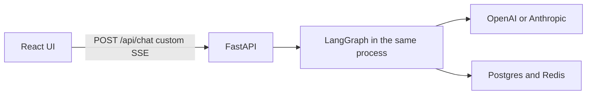

# Propqa is not MCP

**Verdict: this project is not MCP.** It does not implement, host, or call the Model Context Protocol. It is a product chatbot: a React UI talks to its own FastAPI API, which runs one in-process LangGraph agent against Postgres and Redis.

MCP (Model Context Protocol) is a separate open protocol. An AI host (Cursor, Claude Desktop, another agent) discovers tools, resources, and prompts on an MCP server and calls them over JSON-RPC 2.0 (stdio, SSE, or streamable HTTP). Typical signs are an `mcp` or `fastmcp` dependency, `@modelcontextprotocol/sdk`, and handlers for `initialize`, `tools/list`, and `tools/call`.

## Why it is not MCP

- **No protocol surface.** A search of the repo finds no `mcp` files, imports, JSON-RPC methods, `tools/list` / `tools/call`, FastMCP, or the MCP SDK. [pyproject.toml](../pyproject.toml) depends on FastAPI, LangGraph, LangChain, OpenAI, Anthropic, Redis, and Postgres. There is no MCP package.
- **The model is called directly.** [src/agent/services/llm/providers.py](../src/agent/services/llm/providers.py) builds `ChatOpenAI` or Anthropic chat models from `LLM_PROVIDER`. The app is the client of the model vendor. It is not a tool server that some other host connects to.
- **Tools are graph nodes, not MCP tools.** [src/agent/graph/workflow.py](../src/agent/graph/workflow.py) compiles one `StateGraph`: route the question, pick domains, load a YAML catalog, ground names, run a read-only SQL lookup, write the reply, then queue memory. Those steps are Python functions in the same process. Nothing advertises them for an external host to discover.
- **The HTTP API is a chat product, not an MCP transport.** [README.md](../README.md) and [docs/architecture/complete-architecture.md](architecture/complete-architecture.md) describe `POST /api/chat` streaming custom server-sent events (`text`, `reply`, `listings`) to the Vite UI, plus auth, sessions, and leads. That SSE stream is Propqa’s own chat format. MCP’s SSE transport is a different contract (JSON-RPC session, tool listing, tool calls).
- **Data access is internal.** Warehouse SQL, catalog YAML under [src/catalog/](../src/catalog/), Redis checkpoints, and pgvector memory are reached by the graph and a memory worker. They are not exposed as MCP resources.

An MCP system would look like this instead: a host connects to a server, lists tools, and calls them. Propqa has no host/server split of that kind.

## What it is

A conversational agent for the Dubai and UAE property market. LangGraph decides whether a turn needs the warehouse. If it does, a domain router loads one catalog (listings, transactions, locations, and so on) and a guarded text-to-SQL path runs read-only `SELECT`s. Turns that do not need data are answered by the model directly.

Using an agent, tool-like steps, and SSE does not make a project MCP. Those are in-process application pieces. The Cursor session’s `user-n8n-mcp` server is the editor’s own MCP connection. It is not part of this repository.
