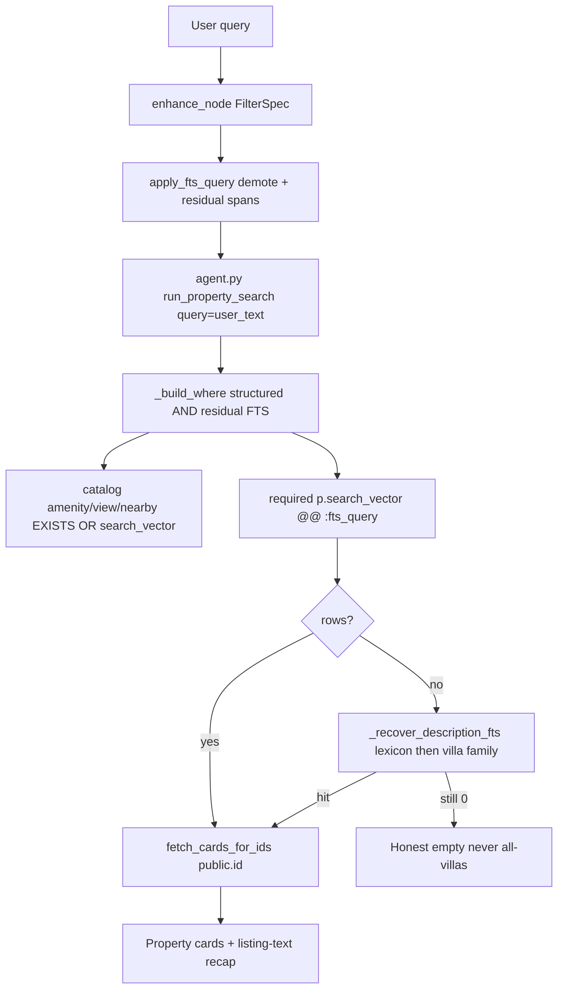

# Full-Text Search in the current property path

## What shipped (vs the original DE sketch)

Phase 0 on the chatbot `DB_*` (`propqaproduction_backup` / public search_path):

- `search_vector` is a stored `tsvector` on **`public.properties`**, not `nlp_store.properties`.
- `nlp_store.properties` exists but has **no** `search_vector`. The join `nlp_store.p_id = public.id` is 100% coverage and is **not** used for FTS.
- `nlp_store.property_images` is **not** on this DB. Image-caption match is a DE follow-up.
- No GIN on `search_vector` yet (latency follow-up).

Weighted document (DE requirement, now on public):

- **A:** `title_en`, building / project / master names
- **B:** developer, address, amenities / views / nearby / category arrays
- **C:** `detail_en`

Retrieval never dumps the raw utterance into `websearch_to_tsquery`. Structured FilterSpec filters stay authoritative. Residual description is bound as `:fts_query`.

## Current pipeline



Layers:

| Step | Module | Role |
|---|---|---|
| Extract | enhance / slot parser / `FilterSpec` | purpose, type, beds, price, location, catalog amenities |
| Demote | [`Backend/property_search/fts_query.py`](Backend/property_search/fts_query.py) `demote_uncatalogued_text_filters` | Unknown amenity prose (`large windows`) → keywords, not EXISTS |
| Residual | `build_fts_query` / `residual_spans` | Leftover **spans**, quoted phrases, generic-tail trim |
| Attach | `apply_fts_query` in [`Backend/agent.py`](Backend/agent.py) and [`Backend/orchestration/nodes/enhance.py`](Backend/orchestration/nodes/enhance.py) | Sets `spec.fts_query` after FilterSpec is final |
| Search | [`Backend/property_filters.py`](Backend/property_filters.py) `run_property_search(..., query=)` | Re-applies FTS, COUNT + SELECT |
| SQL | `p.search_vector @@ websearch_to_tsquery('english', :fts_query)` | Bound param only; `ts_rank` when no explicit `sort_by` |
| Miss | `_recover_description_fts` | Lexicon OR, then villa type-family, then other-type disclosure |
| Cards | [`Backend/property_cards.py`](Backend/property_cards.py) | Hydrate from `public.properties.id` |

`PROPERTY_FTS_ENABLED` defaults **on** (`or "1"`). Set `0` / `false` / `no` / `off` for catalog-only. Knobs in [Backend/.env.example](Backend/.env.example): `PROPERTY_FTS_ENABLED=1`, `PROPERTY_FTS_MIN_TOKEN_LEN=3`, `PROPERTY_FTS_QUERY_MAX_CHARS=200`. Restart the process after changing `.env` (Uvicorn reads env at startup). In-memory response cache is 5 minutes and can replay a pre-FTS answer in the same session.

## Channel map

No per-utterance allowlist. Every leftover span uses the same rules as “high ceilings”.

- **Catalog amenity / view / nearby** (gym, pool, sea view, metro) — `EXISTS` **OR** `p.search_vector` via `_or_search_vector_match`.
- **Unknown prose parked on amenities** — demote, then required residual FTS.
- **Leftover description** after stripping type / purpose / beds / price / location / stops — required `@@` AND.
- **Structured filters stay structured.** FTS does not replace beds, price, or location FKs.
- **Keyword ILIKE** on title/address/type runs only when FTS is inactive.

## Residual matching (spans, not bag-of-AND)

[`build_fts_query`](Backend/property_search/fts_query.py) extracts contiguous leftover spans, trims generic tails (`room`, `area`, `space`, `living` when a modifier remains), and binds quoted websearch phrases.

| User text | Residual `:fts_query` |
|---|---|
| `show apartment with high ceilings` | `"high ceilings"` |
| `villa with double height living room` | `"double height"` |
| `apartment with large windows and natural light` | `"large windows" "natural light"` |
| `luxury apartment in Dubai Marina with large windows` | `"large windows"` (luxury/type/location stripped) |

`websearch_to_tsquery` ANDs unquoted tokens. Four leftover words (`double height living room`) compiled to `'doubl' & 'height' & 'live' & 'room'` and zeroed inventory even when `"double height"` exists. That is why spans + tail-trim exist.

Description lexicon (listing jargon, not the amenity catalog): `double height` / `double volume` ↔ `high ceiling(s)`; `floor-to-ceiling`; `natural light` ↔ `sunlit`; `large windows` ↔ `big windows`; `open plan`.

## Relax ladder (`_recover_description_fts`)

Runs after the first empty `_run_one`, **before** location/purpose widen. Never calls `without_fts_query()` when the spec is only type+purpose (that produced **1736** apartments for sale).

1. Current residual (already tried).
2. Distinctive / lexicon OR (`"double height" OR "high ceiling"`).
3. If type-locked and `allow_widen != "never"`: **type family** — `villas` ↔ `villa-compound` (`FilterSpec.with_type_family`). Does not add apartments.
4. If FTS hits exist only in other types: disclosure *“No villas with that feature; N other listings mention it”* plus those cards.
5. If nothing in `search_vector`: honest empty.

`_can_retry_without_fts` still allows a SQL-error retry without FTS only when beds / price / location / catalog amenities remain.

Live implication for `villa with double height living room`: **1 villa-compound mansion** (inventory has 3 “double height” sale listings total — two apartments, one villa-compound), not 0 and not 169 villas.

## SQL shape (implemented)

No `nlp_store` join. No f-string interpolation of user text.

```sql
SELECT
    p.id, ...existing card columns...,
    ts_rank(p.search_vector, websearch_to_tsquery('english', :fts_query)) AS text_rank
FROM properties p
LEFT JOIN locations lb  ON lb.id  = p.location_building_id
LEFT JOIN locations lp  ON lp.id  = p.location_project_id
LEFT JOIN locations lmp ON lmp.id = p.location_master_project_id
WHERE p.status = 'active'
  AND p.deleted_at IS NULL
  -- existing FilterSpec clauses --
  AND p.search_vector @@ websearch_to_tsquery('english', :fts_query)
ORDER BY text_rank DESC, p.created_at DESC
LIMIT :limit
```

When `sort_by` is set, rank order is skipped. `DISTINCT ON (p.id)` is omitted on the FTS path.

Recap line from [`Backend/agent.py`](Backend/agent.py): **Matched in listing text (title / description):** `{fts_query}`.

## Why FTS is complementary (still true)

| Query class | Behaviour |
|---|---|
| `2BR villa Marina under 2M` | Residual empty → structured SQL only |
| `apartment with large windows / natural light` | Required residual on `detail_en` / title |
| `apartment with gym and large windows` | Gym = catalog OR vector; windows = residual AND |
| `luxury apartment marina` | Luxury stripped (sort adjective); marina is location |
| `show apartment with high ceilings` without FTS | **1736** = all active apartments for sale |
| Same with FTS | ~22 listing-text hits |

Do **not** replace beds / price / purpose / `location_id` with FTS. English stemmer is weak on Dubai proper nouns; location stays on FilterSpec.

## What we will not do

- Rewrite FilterSpec or move listing search to Manticore / pgvector stubs
- Put `nlp_store` first on `DB_SEARCH_PATH` or JOIN it for FTS (column is on public)
- FTS the raw user sentence
- Scan `detail_en` with ILIKE as a substitute
- Point production agents at `AUDIT_DB_*`
- Silently drop `fts_query` into all-apartments / all-villas

## Verify

```text
pytest -q Backend/tests/test_property_fts.py Backend/tests/test_views_nearby_soft_match.py Backend/tests/test_property_filters_sql.py
```

Smoke against the chatbot DB (same binds the app uses):

```sql
SELECT COUNT(*) FROM public.properties p
WHERE p.status = 'active' AND p.deleted_at IS NULL
  AND p.purpose = 'for_sale'
  AND p.search_vector @@ websearch_to_tsquery('english', :fts_query);
```

`:fts_query = '"high ceilings"'` vs `'"double height"'`. After code reload, send description queries in a **new chat** (5-minute response cache).

## Risks / follow-ups

- **GIN missing:** `@@` can sequential-scan; ask DE for `CREATE INDEX … USING GIN (search_vector)`
- **Image captions:** not in this DB’s vector; “large windows” in photo text still misses
- **Stale / NULL `search_vector`:** residual AND returns 0; do not fail-open to unfiltered inventory
- **Response cache:** identical session+query can replay a pre-FTS 1736 / 0-result answer for 5 minutes
- **Lexicon growth:** add listing jargon groups in `fts_query.py`, not full user-query allowlists
